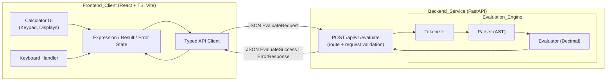
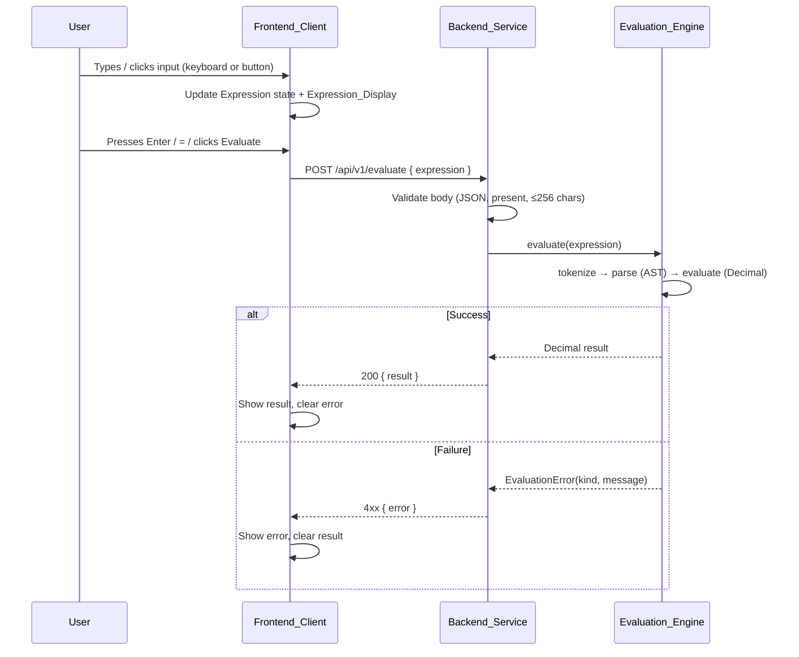
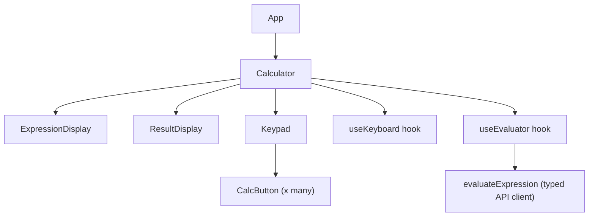
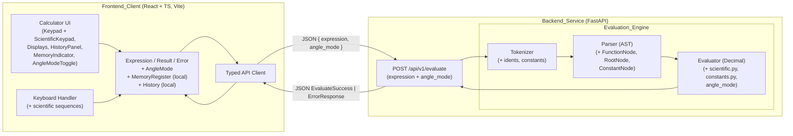

# Design Document

## Overview

This document describes the technical design for a modern, responsive web calculator that evaluates chained arithmetic expressions under strict PEMDAS precedence with exact decimal arithmetic. The system is split into two independently testable halves connected by a single REST contract:

- **Backend_Service** (Python 3.11+ / FastAPI): Owns all arithmetic. It exposes `POST /api/v1/evaluate`, which accepts an expression string, runs it through an **Evaluation_Engine** (tokenizer → recursive-descent parser producing an AST → evaluator over `decimal.Decimal`), and returns either a numeric result or a structured error.
- **Frontend_Client** (React + TypeScript, Vite): Owns all UI and input state. It renders a physical-calculator layout, captures mouse/touch/keyboard input, maintains the current expression string, calls the backend for evaluation, and renders results/errors. It performs **no** arithmetic locally.

The central design principle (Requirement 14) is a hard separation of concerns: the frontend is a stateful input/rendering surface, the backend is a stateless math oracle, and the only coupling between them is the typed JSON contract of the Evaluate_Endpoint.

### Key Design Decisions

| Decision | Rationale | Requirements |
| --- | --- | --- |
| Exact arithmetic via Python `decimal.Decimal` throughout the evaluator | Avoids binary floating-point error (`0.1 + 0.2` must equal `0.3`) | 3.1–3.4 |
| Hand-written recursive-descent parser producing an explicit AST | Gives full control over PEMDAS precedence, unary minus, right-associative exponentiation, and enables the round-trip property | 2.1–2.6, 6.1–6.4 |
| All calculation server-side; frontend never computes | Enforces separation of concerns and a single source of arithmetic truth | 14.1–14.4 |
| Discriminated union response (`result` XOR `error`) | Unambiguous success/failure distinction for the typed client | 5.5, 13.1–13.5 |
| Error taxonomy mapped 1:1 to 4xx responses | Descriptive, testable error handling | 4.1–4.6 |
| CSS Grid keypad + `clamp()`/media queries | Responsive, no overflow, ≥44px touch targets on mobile | 8.1–8.4, 9.1–9.4 |
| ARIA live regions + labels + role fallback | Screen reader conveys state changes | 11, 12 |

## Architecture



### Request Flow



The layers are strictly ordered: transport (FastAPI route) → validation → tokenizer → parser → evaluator. Each layer only depends on the layer directly below it, which keeps the pure computation (tokenizer/parser/evaluator) free of HTTP concerns and independently unit-testable (Requirement 14, 15).

## Components and Interfaces

### Backend Components

#### 1. API Layer (`app/api/routes.py`)
- Defines the FastAPI router and the `POST /api/v1/evaluate` handler (Requirement 5.1).
- Uses a Pydantic request model to enforce the body shape and the 1–256 character constraint (Requirements 5.2, 5.6, 1.5).
- Delegates evaluation to the Evaluation_Engine and maps outcomes to HTTP responses:
  - Success → `200` with `{ "result": "<string>" }`, `Content-Type: application/json` (Requirement 5.3, 5.5).
  - Domain evaluation errors → `422` (or `400` for malformed body) with `{ "error": "<message>" }` (Requirements 4.6, 5.4, 5.5).
- Never returns both `result` and `error` (Requirement 5.5).

#### 2. Evaluation_Engine (`app/engine/`)
The pure computation core, HTTP-agnostic. Public entry point:

```python
def evaluate_expression(expression: str) -> Decimal:
    """Tokenize, parse, and evaluate an arithmetic expression.
    Raises EvaluationError subclasses on any failure."""
```

Sub-components:

- **Tokenizer** (`tokenizer.py`): Converts the raw string into a token stream. Recognizes numbers (with a single decimal point), operators `+ - * / ^`, and parentheses `( )`. Rejects any other character with `InvalidCharacterError` (Requirement 4.4). Skips insignificant whitespace.
- **Parser** (`parser.py`): Recursive-descent parser that consumes tokens and produces an AST. Encodes PEMDAS precedence and associativity directly in its grammar (Requirements 2.1–2.6, 6.1). Raises `SyntaxError`-family errors for invalid operator sequences (Requirement 4.2), unclosed parentheses (Requirement 4.3), and empty input (Requirement 4.5). Provides an inverse `render(node) -> str` used by the round-trip property (Requirement 6.3).
- **Evaluator** (`evaluator.py`): Walks the AST and computes a `Decimal` using a configured `decimal.Context`. Raises `DivisionByZeroError` when a divisor evaluates to zero (Requirement 4.1). Applies rounding for non-terminating results (Requirement 3.4).
- **Errors** (`errors.py`): The `EvaluationError` hierarchy (see Error Handling).

#### 3. Application Assembly (`app/main.py`)
- Instantiates the FastAPI app, mounts the router, and configures CORS so the Vite dev server (and deployed frontend) can call the endpoint (supports Requirement 14.3).

### Frontend Components

Component tree:



- **`App`**: Root shell, layout container, mounts `Calculator`.
- **`Calculator`**: Owns all state (expression, result, error, status). Wires the keypad, displays, keyboard hook, and evaluation hook. Contains the reducer/state logic (Requirement 14.1).
- **`ExpressionDisplay`**: Renders the current expression string; empty in initial state (Requirements 7.1, 7.3). `aria-live="polite"` (Requirement 12.3).
- **`ResultDisplay`**: Renders the result or error message; empty in initial state (Requirements 7.2, 7.4, 7.5). Result region `aria-live="polite"`, error region `aria-live="assertive"` (Requirements 12.3, 12.4).
- **`Keypad`**: CSS Grid layout of `CalcButton`s in the physical calculator arrangement (Requirements 8.1–8.4).
- **`CalcButton`**: A native `<button>` with visible label and `aria-label` matching its function (Requirements 11.6, 12.1, 12.2).
- **`useKeyboard`**: Global `keydown` listener mapping keys to actions (Requirement 10.1–10.8).
- **`useEvaluator`**: Calls the typed API client, manages loading/error, and enforces that results only come from the backend (Requirements 14.3, 14.4).

### API Contract

**Endpoint:** `POST /api/v1/evaluate`

Request body:
```json
{ "expression": "12.5 + 3 * (4 - 1.5) / 2" }
```

Success response — `200 OK`, `Content-Type: application/json`:
```json
{ "result": "8.25" }
```

Error response — `4xx`, `Content-Type: application/json`:
```json
{ "error": "Division by zero is not allowed." }
```

The `result` field is a **string** carrying the exact decimal representation, avoiding any JSON-number/float coercion that would reintroduce precision loss (Requirements 3.1–3.3). Success and error payloads are mutually exclusive (Requirement 5.5).

Corresponding TypeScript interfaces (Requirement 13):
```typescript
export interface EvaluateRequest {
  expression: string;
}
export interface EvaluateSuccess {
  result: string;
}
export interface ErrorResponse {
  error: string;
}
export type EvaluateResponse = EvaluateSuccess | ErrorResponse;

// Narrowing guards (Requirement 13.5)
export function isSuccess(r: unknown): r is EvaluateSuccess { /* checks shape */ }
export function isError(r: unknown): r is ErrorResponse { /* checks shape */ }
```
The client constructs requests conforming to `EvaluateRequest` with no use of `any` (Requirement 13.4). Any response that satisfies neither guard is treated as an error (Requirement 13.5).

## Data Models

### Grammar

The parser implements the following grammar (EBNF-style), with productions ordered from lowest to highest precedence to encode PEMDAS. This is the source of truth for Requirements 2.1–2.6 and 6.1.

```
expression   = term , { ("+" | "-") , term } ;          (* add/sub, left-assoc *)
term         = factor , { ("*" | "/") , factor } ;       (* mul/div, left-assoc *)
factor       = unary , [ "^" , factor ] ;                (* exponent, right-assoc *)
unary        = ("-" , unary) | primary ;                 (* unary minus *)
primary      = number | "(" , expression , ")" ;
number       = digit , { digit } , [ "." , digit , { digit } ]
             | "." , digit , { digit } ;
```

Precedence, low → high: `+ -` < `* /` < `^` < unary `-` < parentheses. Note that `factor = unary , [ "^" , factor ]` makes `^` right-associative (Requirement 2.4), and because the exponent's base is a `unary` while the whole `^` chain sits above unary minus at the top level, `-3^2` parses as `-(3^2)` = `-9` (Requirement 2.6).

### AST Node Types

```python
@dataclass(frozen=True)
class NumberNode:
    value: Decimal            # exact operand value

@dataclass(frozen=True)
class UnaryOpNode:
    op: str                   # "-"
    operand: "Node"

@dataclass(frozen=True)
class BinaryOpNode:
    op: str                   # "+", "-", "*", "/", "^"
    left: "Node"
    right: "Node"

Node = NumberNode | UnaryOpNode | BinaryOpNode
```

### Token Model

```python
class TokenType(Enum):
    NUMBER = auto()
    PLUS = auto(); MINUS = auto(); STAR = auto(); SLASH = auto(); CARET = auto()
    LPAREN = auto(); RPAREN = auto()
    EOF = auto()

@dataclass(frozen=True)
class Token:
    type: TokenType
    lexeme: str
    position: int             # index in source, used for error messages
```

### Request/Response Models (Pydantic)

```python
class EvaluateRequest(BaseModel):
    expression: str = Field(min_length=1, max_length=256)   # Req 5.2, 5.6, 1.5

class EvaluateSuccess(BaseModel):
    result: str                                             # Req 5.3, 5.5

class ErrorResponse(BaseModel):
    error: str                                              # Req 5.4, 5.5
```

### Decimal Precision Model

- A module-level `decimal.Context` is configured with sufficient working precision (e.g., `prec = 50`) so intermediate operations do not lose significance.
- All operands are constructed as `Decimal(str_literal)` directly from their source lexemes (never via `float`), guaranteeing exact operand values (Requirement 3.3).
- Terminating results are returned as-is with trailing-zero normalization so `0.1 + 0.2` yields exactly `0.3` (Requirements 3.1, 3.2).
- Non-terminating quotients (e.g., `1 / 3`) are rounded to at least 10 significant digits using `ROUND_HALF_EVEN` (Requirement 3.4).

## Correctness Properties

*A property is a characteristic or behavior that should hold true across all valid executions of a system — essentially, a formal statement about what the system should do. Properties serve as the bridge between human-readable specifications and machine-verifiable correctness guarantees.*

The arithmetic core (tokenizer → parser → evaluator) is a pure function over strings, which makes it an ideal target for property-based testing. The following properties are derived from the prework analysis. Precedence and associativity criteria (Requirements 2.1–2.6, 1.1–1.4) are consolidated into a single model-based property (P1) that compares the engine against a reference `Decimal` evaluation of the parsed AST, because a shared reference oracle validates all of these rules simultaneously. UI-layout, contrast, and pure type-definition criteria are handled by non-PBT strategies (see Testing Strategy) rather than as properties.

### Property 1: Engine matches PEMDAS/Decimal reference evaluation

*For any* valid expression generated from the arithmetic grammar, evaluating it with the Evaluation_Engine SHALL produce a result equal (to at least 10 significant decimal digits) to an independent reference evaluation of the same parsed AST computed with exact `Decimal` arithmetic under PEMDAS precedence and the specified associativity (left-to-right for `+ - * /`, right-to-left for `^`, exponentiation before unary minus).

**Validates: Requirements 1.1, 1.2, 1.3, 1.4, 2.1, 2.2, 2.3, 2.4, 2.5, 2.6, 3.2, 3.3, 6.1**

### Property 2: Non-terminating division is rounded to ≥10 significant digits (round-half-even)

*For any* expression whose exact mathematical result is a non-terminating decimal, the Evaluation_Engine SHALL return a value with at least 10 significant decimal digits that equals the `Decimal` division of the same operands performed under the configured context using `ROUND_HALF_EVEN`.

**Validates: Requirements 3.4**

### Property 3: Parser round-trip preserves value

*For any* valid AST generated by the grammar, rendering it to an expression string and parsing that string again SHALL yield a structure that, when evaluated, produces a result equal to the original AST's evaluation to at least 10 significant decimal digits, thereby conforming to the same PEMDAS precedence.

**Validates: Requirements 6.3, 6.4**

### Property 4: Division by zero always signals an error

*For any* expression in which a divisor subexpression evaluates to zero, the Evaluation_Engine SHALL raise a division-by-zero error (surfaced by the Backend_Service as a 4xx Error_Response with a descriptive message) and SHALL NOT return a calculated result.

**Validates: Requirements 4.1**

### Property 5: Invalid characters always signal an error

*For any* otherwise-valid expression into which a character that is not an operator, digit, decimal point, or parenthesis is inserted, the Backend_Service SHALL return an Error_Response with a descriptive message identifying the invalid character and SHALL NOT return a result.

**Validates: Requirements 4.4**

### Property 6: Response shape is an unambiguous success-XOR-error discriminated union

*For any* request submitted to the Evaluate_Endpoint, the response SHALL contain exactly one of the `result` field or the `error` field (never both, never neither); a successful evaluation SHALL yield HTTP 200 with a `result` and `Content-Type: application/json`, and any failed evaluation SHALL yield an HTTP 4xx status with an `error`.

**Validates: Requirements 4.6, 5.3, 5.4, 5.5**

### Property 7: Expressions exceeding the length limit are rejected

*For any* expression string longer than 256 characters, the Backend_Service SHALL reject it with a 4xx Error_Response whose message identifies that the maximum length was exceeded, and SHALL NOT return a calculated result.

**Validates: Requirements 1.5, 5.6**

### Property 8: Mapped character keys append their character

*For any* key mapped to a character (digits `0`–`9`, operators `+ - * /`, decimal point `.`, and parentheses `( )`), pressing that key SHALL append exactly that character to the current Expression, increasing its length by one.

**Validates: Requirements 10.1, 10.2, 10.3**

### Property 9: Backspace removes exactly the last character

*For any* non-empty Expression, pressing `Backspace` SHALL produce an Expression equal to the original with its final character removed (length decreased by exactly one).

**Validates: Requirements 10.5**

### Property 10: Escape resets to the empty state

*For any* Frontend_Client state, pressing `Escape` SHALL result in an empty Expression and a cleared Result_Display.

**Validates: Requirements 10.7**

### Property 11: Unmapped keys are no-ops

*For any* key that is not mapped to a calculator function, pressing it SHALL leave both the Expression and the Result_Display unchanged.

**Validates: Requirements 10.8**

### Property 12: Every control exposes a matching accessible label

*For any* interactive calculator control rendered by the Frontend_Client, the control SHALL expose an `aria-label` whose value corresponds to the control's visible function.

**Validates: Requirements 12.1**

### Property 13: Non-conforming responses are treated as errors

*For any* JSON payload returned from the Evaluate_Endpoint that conforms to neither the `EvaluateSuccess` interface nor the `ErrorResponse` interface, the Frontend_Client SHALL treat the response as an error and display an error message to the User.

**Validates: Requirements 13.5**

## Error Handling

All domain errors derive from a common `EvaluationError` base carrying a `kind` and a human-readable `message`. The API layer maps each to a 4xx status and an `ErrorResponse` body (Requirement 4.6, 5.4). No error path returns a `result` field (Requirement 5.5).

| Error class | Trigger | Layer | HTTP status | Message (descriptive) | Requirement |
| --- | --- | --- | --- | --- | --- |
| `EmptyExpressionError` | Empty or whitespace-only expression | Parser | 422 | "No expression was provided." | 4.5 |
| `InvalidCharacterError` | Character outside `[0-9. +-*/^()]` | Tokenizer | 422 | "Invalid character '{c}' at position {i}." | 4.4 |
| `InvalidSyntaxError` | Invalid operator sequence / malformed structure | Parser | 422 | "Invalid operator sequence near position {i}." | 4.2 |
| `UnbalancedParenthesesError` | Unclosed / unmatched parenthesis | Parser | 422 | "Unclosed parenthesis at position {i}." | 4.3 |
| `DivisionByZeroError` | Divisor subexpression evaluates to zero | Evaluator | 422 | "Division by zero is not allowed." | 4.1 |
| Request validation (Pydantic) | Malformed JSON, missing field, >256 chars | API/transport | 400 / 422 | "Request body is malformed or the expression exceeds the maximum length of 256 characters." | 1.5, 5.6 |

Handling flow:
- The tokenizer and parser fail fast on the first violation, preserving the source position for descriptive messages.
- A single FastAPI exception handler catches `EvaluationError` subclasses and serializes them to `ErrorResponse`, choosing the mapped status code.
- Pydantic validation failures (invalid/missing/oversize body) are caught by an exception handler that returns the same `ErrorResponse` shape rather than FastAPI's default error body, so the frontend contract stays uniform (Requirement 5.6, 13.5).

Frontend error handling:
- On a 4xx response, the client parses `error` and renders it in the Result_Display's error region, clearing any prior result (Requirements 7.5, 7.6).
- On a network/transport failure (backend unreachable), the client shows a fixed "The evaluation service is unavailable." message and never displays a locally computed result (Requirement 14.4).
- On a response matching neither typed shape, the client falls back to a generic error (Requirement 13.5).

## Testing Strategy

### Dual Approach

The backend arithmetic core is tested with **both** property-based tests (universal correctness across generated inputs) and example-based unit tests (specific documented behaviors, edge cases, and error conditions). The frontend is tested primarily with example-based component/reducer tests plus a small set of property-style tests for its pure reducer logic; layout and contrast are validated with tooling and manual review because they are not expressible as universal computable properties.

### Property-Based Testing (Backend)

- **Library:** [Hypothesis](https://hypothesis.readthedocs.io/) for Python. We do not implement property testing from scratch.
- **Generators:** A recursive strategy builds random valid ASTs (numbers as `Decimal` from string literals, unary minus, binary `+ - * / ^`, nested parentheses) with bounded depth; a `render(ast)` function serializes them to strings for the round-trip and model-based properties. Separate strategies generate invalid inputs (disallowed characters, zero divisors, over-length strings).
- **Configuration:** Each property test runs a **minimum of 100 iterations** (`@settings(max_examples=100)` or higher).
- **Reference oracle:** A small independent evaluator over the AST using `Decimal` provides the expected value for Property 1 (model-based testing).
- **Tagging:** Each property test is tagged with a comment in the form
  `# Feature: web-calculator, Property {number}: {property_text}`.

Property → test mapping:

| Property | Test focus | Requirements |
| --- | --- | --- |
| P1 | Engine result == reference Decimal AST evaluation | 1.1–1.4, 2.1–2.6, 3.2, 3.3, 6.1 |
| P2 | Non-terminating division rounding / ≥10 sig digits | 3.4 |
| P3 | `evaluate(parse(render(ast))) == evaluate(ast)` | 6.3, 6.4 |
| P4 | Zero-divisor expressions raise div-by-zero → 4xx | 4.1 |
| P5 | Injected invalid character → error | 4.4 |
| P6 | Response has exactly one of result/error, correct status | 4.6, 5.3, 5.4, 5.5 |
| P7 | Strings > 256 chars rejected | 1.5, 5.6 |

### Example-Based Unit Tests (Backend, pytest)

Focused examples complement the properties (Requirement 15):
- **PEMDAS across ≥3 precedence levels** (Requirement 15.1): e.g. `2 + 3 * 4 ^ 2 == 50`, `12.5 + 3 * (4 - 1.5) / 2 == 16.25`, asserting exact expected values.
- **Associativity/unary examples**: `2^2^3 == 256` (2.4), `8/4/2 == 1` and `8-4-2 == 2` (2.5), `-3^2 == -9` (2.6).
- **Decimal exactness**: `0.1 + 0.2 == Decimal("0.3")` (3.1).
- **Each Requirement 4 error case** (Requirement 15.2): division by zero, invalid operator sequence (`3 + * 4`), unclosed parentheses (`(1 + 2`), invalid characters (`2 & 3`), empty/whitespace (`""`, `"   "`) — each asserting an Error_Response with a 4xx status.
- **Boundary lengths**: expressions of length 1 and 256 accepted; 257 rejected (5.2, 5.6).
- **Round-trip test presence** (Requirement 15.3): the Hypothesis round-trip property (P3) satisfies the mandated round-trip parsing test across many samples.
- The full suite must pass (Requirement 15.4).

### Frontend Testing

- **Framework:** [Vitest](https://vitest.dev/) + [React Testing Library](https://testing-library.com/docs/react-testing-library/intro/); network calls mocked (e.g., MSW).
- **Reducer property-style tests** (pure state logic): P8 (character-append over the set of mapped keys), P9 (backspace removes last char), P10 (escape resets), P11 (unmapped keys no-op). These use fast-check-style generation or table-driven cases over the key set. Requirements 10.1–10.8.
- **Component/example tests:**
  - Displays empty initially; expression display updates on input; result/error rendered; result and error mutually exclusive (Requirements 7.1–7.6).
  - All required controls present; keypad arrangement 7-8-9 / 4-5-6 / 1-2-3 with 0 below; operators grouped (Requirements 8.1–8.3).
  - `aria-label` present on every control matching function (P12 / Requirement 12.1); `aria-live` regions configured `polite`/`assertive` (Requirements 12.3–12.5); active-state indication on press (11.5); visible labels (11.6).
  - API client: builds a typed `EvaluateRequest`; success renders result; 4xx renders error; malformed response treated as error (P13 / Requirement 13.5); network failure shows "service unavailable" and no local result (Requirement 14.4); results only appear via an API call (Requirement 14.3).
- **Type safety** (Requirements 13.1–13.4): enforced by `tsc` strict mode and an ESLint `no-explicit-any` rule over client code, verified in CI.

### Layout, Responsiveness, and Contrast (non-PBT)

These criteria are visual/measured and are not expressible as universal properties:
- **Responsive layout** (Requirements 8.4, 9.1–9.4): checked at representative viewport widths (mobile 320–767, tablet 768–1023, desktop 1024–2560) for no horizontal overflow, no clipping, and ≥44×44px touch targets on mobile — via component tests reading computed styles and/or visual regression.
- **Contrast** (Requirements 11.1–11.4): validated with an automated accessibility audit (e.g., axe-core) plus manual review. Full WCAG conformance requires manual testing with assistive technologies and expert review, which the automated checks supplement but do not replace.

### Module / File Structure

```
backend/
  app/
    main.py                 # FastAPI app assembly, CORS, exception handlers
    api/
      routes.py             # POST /api/v1/evaluate
      schemas.py            # Pydantic EvaluateRequest/Success/ErrorResponse
    engine/
      __init__.py           # evaluate_expression(expr) entry point
      tokenizer.py
      parser.py             # parse() + render()
      evaluator.py          # Decimal evaluation, context/rounding
      errors.py             # EvaluationError hierarchy
  tests/
    test_pemdas.py          # example-based PEMDAS + associativity
    test_errors.py          # Requirement 4 error cases
    properties/
      strategies.py         # Hypothesis AST generators + render
      test_engine_property.py    # P1, P2
      test_roundtrip.py          # P3
      test_error_properties.py   # P4, P5
    test_api.py             # P6, P7, response shape, status codes

frontend/
  src/
    api/
      types.ts              # EvaluateRequest / EvaluateSuccess / ErrorResponse + guards
      client.ts             # evaluateExpression()
    state/
      calculatorReducer.ts  # pure expression/result/error state transitions
    hooks/
      useKeyboard.ts
      useEvaluator.ts
    components/
      Calculator.tsx
      ExpressionDisplay.tsx
      ResultDisplay.tsx
      Keypad.tsx
      CalcButton.tsx
    App.tsx
    styles/                 # responsive grid, contrast-compliant theme
  tests/
    reducer.test.ts         # P8–P11
    components.test.tsx      # displays, layout presence, a11y (P12)
    client.test.ts          # P13, success/error/network handling
```

---

# Stage 2 Design (Scientific Calculator Extension)

This part extends the Stage 1 web calculator into a scientific calculator. **All Stage 1 design above remains authoritative and unchanged** — the tokenizer → parser → evaluator pipeline, the `decimal.Decimal` precision model, the discriminated-union API contract, the pure React reducer, and the accessibility/responsiveness strategy all carry forward. Stage 2 is purely additive: new tokens, grammar productions, AST nodes, evaluator operations, one new request field, and new frontend surfaces (scientific keypad, memory register, history panel, angle-mode toggle). Nothing here weakens or overrides Requirements 1–15 (Requirement 16.3).

Stage 2 keeps the same non-negotiable rules from the steering (`product.md`, `tech.md`, `structure.md`): **never use raw `float` in a calculation path**, **the frontend computes no evaluation result** (every scientific value comes from the backend — Requirement 24.7), the **success/error contract stays mutually exclusive**, and **accessibility is part of "done"**.

## Stage 1 Codebase Inspection Report

Requirement 16 mandates a written inspection of the Stage 1 codebase across four categories — **bugs**, **architectural flaws**, **decimal precision issues**, and **missing edge-case handlers** — with each category covered either by a documented defect (affected component, trigger, expected vs. actual) or an explicit "none found" record. The findings below are grounded in the actual Stage 1 source (`backend/app/engine/{tokenizer,parser,evaluator,errors}.py`, `backend/app/api/{routes,schemas}.py`, `backend/app/main.py`). Any remediation MUST preserve every Stage 1 acceptance criterion (Requirements 1–15) and must not be considered complete if it regresses one (Requirements 16.3, 16.5); corrected behavior for engine-affecting fixes is locked in with pytest tests (Requirement 16.4) and the full suite must pass with zero failures/errors (Requirement 16.6).

### Category 1 — Bugs

**No functional code bug found.** The tokenizer, parser, and evaluator were read end-to-end and cross-checked against Requirements 1–6. PEMDAS structure, left-associativity of `+ - * /`, right-associativity of `^`, unary-minus grouping, and the `-3^2 == -9` convention are all implemented correctly in `parser.py` (`_factor` wraps `_power`, so `^` binds tighter than unary minus). The evaluator's division-by-zero guard, `0 ** negative` guard, and `NaN`/`Infinity` rejection in `_power()` are correct. No incorrect-result or crash-inducing input was identified during inspection.

### Category 2 — Architectural Flaws

**One documentation/spec inconsistency found (not a code defect).**

| Field | Finding |
| --- | --- |
| Affected component | Stage 1 design prose — "Data Models → Grammar" precedence sentence ("`+ -` < `* /` < `^` < unary `-` < parentheses") |
| Trigger | Reading the Stage 1 design precedence table against `parser.py` and Requirement 2.6 |
| Expected | Prose should state exponentiation binds **tighter** than unary minus (so `-3^2 == -9`), matching the grammar `factor = ("-" factor) | power` and `power = primary ["^" factor]` |
| Actual | The prose lists `^` *below* unary `-`, which, read literally, would imply `-3^2 == 9`. The implementation is correct; only the prose ordering is misleading. `parser.py` already carries a `.. note::` flagging this. |
| Assessment | Documentation inconsistency, **not** a code bug. The code and Requirement 2.6 agree. |
| Recommended remediation | Correct the Stage 1 design prose to read `+ -` < `* /` < unary `-` < `^` < parentheses (unary minus looser than `^`), aligning the table with the grammar and the `parser.py` note. No code change; no risk to Requirements 1–15. |

The layering (transport → validation → pure `engine`) is clean and matches `structure.md`; the `engine` package imports no HTTP concerns. No structural flaw found.

### Category 3 — Decimal Precision Issues

**No precision defect found; one forward-looking observation for Stage 2.**

- The evaluator runs every walk under a module-level `decimal.Context(prec=50, rounding=ROUND_HALF_EVEN)` and constructs operands via `Decimal(lexeme)` directly from source text. A repository-wide reading found **no `float` in any calculation path** (consistent with the `product.md` rule). Terminating results are normalized (trailing zeros stripped, integers kept plain); non-terminating results are detected via the `Inexact` flag and rounded to ≥10 significant digits. This satisfies Requirements 3.1–3.4.
- **Observation for Stage 2:** the `Inexact`-flag-based finalization means that any irrational result — which includes essentially every non-trivial `sin`/`cos`/`tan`/`ln`/`log10`/`sqrt` output — will always be flagged inexact and therefore always rounded to ≥10 significant digits. This is exactly the behavior Requirements 17.6 and 18.6 require, so the Stage 1 finalization strategy carries forward **unchanged** and already satisfies the Stage 2 rounding rule. No change needed.

### Category 4 — Missing Edge-Case Handlers

**One message-clarity edge case found (low severity).**

| Field | Finding |
| --- | --- |
| Affected component | `tokenizer.py` number scan + `parser.py` `_primary`/`parse` |
| Trigger | Input such as `1.2.3` |
| Expected | A clearly worded error naming a malformed number |
| Actual | The tokenizer stops the first number run at the second dot, producing `NUMBER "1.2"` then `NUMBER ".3"`. The parser then sees two adjacent NUMBER tokens and raises `InvalidSyntaxError` at the position of the second number. The outcome is correct (a 4xx error, no result — satisfying Requirement 4.2) but the message ("Invalid operator sequence near position N") points at a position rather than naming the malformed number. |
| Assessment | Correct behavior, suboptimal message clarity. Edge case, not a correctness bug. |
| Recommended remediation | Optionally detect adjacent NUMBER tokens (or a number lexeme containing two dots) and raise `InvalidSyntaxError` with a message like "Malformed number near position N." This is cosmetic; it must not change which inputs are accepted/rejected (preserve Requirement 4.2 behavior). |

All Requirement 4 error paths (empty, invalid character, invalid syntax, unbalanced parentheses, division by zero) are present and mapped to 4xx in `main.py`. No missing handler that changes accept/reject outcomes was found.

### Inspection Summary

| Category | Outcome |
| --- | --- |
| Bugs | None found |
| Architectural flaws | 1 documentation inconsistency (precedence prose); recommend prose correction, no code change |
| Decimal precision | None found; Stage 1 finalization already satisfies Stage 2 rounding |
| Missing edge-case handlers | 1 message-clarity edge case (`1.2.3`); optional cosmetic improvement |

Remediation of the two cosmetic items is optional and, if performed, is covered by pytest tests asserting the corrected behavior (Requirement 16.4) while the existing Stage 1 suite continues to pass unchanged (Requirements 16.3, 16.6).

## Stage 2 Architecture

The shape of the system is unchanged — a stateful React client talking to a stateless FastAPI math oracle over one typed endpoint. Stage 2 adds an `angle_mode` field to the request, two new engine modules (`constants.py`, `scientific.py`), and new frontend surfaces. The frontend gains two pieces of **local-only UI state** (memory register, calculation history) that are explicitly *not* arithmetic evaluation (see the memory decision note below).



The layered ordering (transport → validation → tokenizer → parser → evaluator) and the purity of the `engine` package are preserved. `angle_mode` is threaded as a plain parameter from the route down to the evaluator; it introduces no HTTP coupling into the engine (the engine receives a validated string/enum, not a request object).

## Stage 2 Components and Interfaces

### Backend — Evaluation_Engine extension

#### Tokenizer (`engine/tokenizer.py`) — new lexemes

New `TokenType` members are added alongside the Stage 1 set: `IDENT` (function names and constant names) — or, if preferred, distinct `FUNCTION` and `CONSTANT` types resolved at lex time, and `COMMA` (for the two-argument n-th root). Single-character operator handling is unchanged.

- **Lexing approach for multi-letter identifiers:** when the scanner sees an ASCII letter, it reads a maximal run of `[a-zA-Z]` (letters only; digits are not part of an identifier so `sin2` lexes as `sin` then `2`). The run is matched against a known-name table:
  - Function names: `sin, cos, tan, asin, acos, atan, ln, log10, sqrt`, plus the n-th-root name `root` (see parser note).
  - Constant names: `pi`, `e`.
  - A matched function name becomes a function token; a matched constant becomes a constant token; **any unrecognized identifier run raises a descriptive `InvalidFunctionError`** (new, see Errors) naming the unknown identifier and its position.
- The allowed character set expands to include ASCII letters and `,`. Characters still outside the expanded set continue to raise the Stage 1 `InvalidCharacterError` (Requirement 4.4 preserved). Whitespace handling and number scanning are unchanged.
- **`log10` lexing note:** `log10` is read as a letter-run `log` immediately followed by digits `10`. Because an identifier run is letters-only, the tokenizer recognizes `log10` as a dedicated multi-character keyword (special-cased: after reading the `log` letter-run, if the next two characters are `10`, consume them as part of the `log10` function name). This keeps `log10(x)` unambiguous and avoids colliding with a hypothetical `log` name.

#### Parser / Grammar (`engine/parser.py`) — new productions and nodes

The Stage 1 grammar is extended only at the `primary` level, so all existing precedence/associativity is untouched:

```
primary   = number
          | constant
          | function
          | "(" , expression , ")" ;
constant  = "pi" | "e" ;
function  = unaryfunc , "(" , expression , ")"
          | "root" , "(" , expression , "," , expression , ")" ;
unaryfunc = "sin" | "cos" | "tan" | "asin" | "acos" | "atan"
          | "ln" | "log10" | "sqrt" ;
```

- **n-th root syntax decision:** use a **two-argument function `root(x, n)`** meaning "the n-th root of `x`" (radicand first, degree second). Rationale: it reuses the function-call machinery already needed for the unary functions (one grammar production, one parenthesized-arguments path), avoids inventing a new infix operator and its precedence/associativity rules, and keeps `render()` trivial (a function call always re-parses unambiguously). It also composes naturally with the existing exponentiation operator `^`, which remains the way to express powers (Requirement 18.1).
- **New AST node types** (frozen dataclasses, matching the Stage 1 style):

```python
@dataclass(frozen=True)
class ConstantNode:
    name: str                 # "pi" | "e"

@dataclass(frozen=True)
class FunctionNode:
    name: str                 # "sin" | "cos" | ... | "sqrt"  (unary scientific fns)
    operand: "Node"

@dataclass(frozen=True)
class RootNode:
    radicand: "Node"          # x in root(x, n)
    degree: "Node"            # n in root(x, n)

Node = NumberNode | UnaryOpNode | BinaryOpNode | ConstantNode | FunctionNode | RootNode
```

- **`render()` round-trip** is extended to cover the new nodes (Requirement 6.3 carried forward): a `ConstantNode` renders to `pi`/`e`; a `FunctionNode` renders to `name(render(operand))`; a `RootNode` renders to `root(render(radicand), render(degree))`. Function/constant forms are self-parenthesizing (a function call or bare constant is itself a `primary`), so they need no extra precedence wrapping and re-parse to a structurally equivalent tree.
- A function name not followed by `(`, a missing comma in `root`, or a missing argument raises the Stage 1 `InvalidSyntaxError` with position (Requirement 4.2 preserved).

#### Evaluator (`engine/evaluator.py` + `engine/scientific.py` + `engine/constants.py`) — Decimal scientific operations

All scientific math runs under the same `decimal.Context(prec=50, ROUND_HALF_EVEN)` and reuses the Stage 1 `_finalize` path, so results are automatically rounded to ≥10 significant digits when non-terminating (Requirements 17.6, 18.6). The evaluator gains an `angle_mode` parameter (default `"radians"`) threaded through the walk.

- **Constants (`engine/constants.py`):** `pi` and `e` are stored as high-precision `Decimal` literals well beyond 10 digits (≥50 significant digits, matching the working precision). They are returned as exact `Decimal` operands when a `ConstantNode` is evaluated (Requirements 19.1, 19.2). `pi` is also the basis for degree↔radian conversion (Requirement 17.5), computed as `radians = degrees * pi / 180` and `degrees = radians * 180 / pi` entirely in `Decimal`.
- **`decimal`-native operations (no bridging needed):** `Decimal.ln()`, `Decimal.log10()`, `Decimal.sqrt()`, `Decimal.exp()`, and `Decimal.__pow__`/`Context.power` are used directly for `ln`, `log10`, `sqrt`, powers, and `e`-based work. These are exact-decimal and respect the context precision.
- **Trig / inverse trig (`engine/scientific.py`) — Decimal-native algorithm:** `decimal` does **not** provide `sin/cos/tan/asin/acos/atan`. Per the `product.md` rule "never use raw `float` in calculation paths", these are implemented with a **`Decimal`-based algorithm**, not by bridging through `float`:
  - Convert the argument to radians (if `angle_mode == "degrees"`, multiply by `pi/180` in `Decimal`).
  - **Range-reduce** the radian argument into a small interval around 0 using the `Decimal` value of `pi` (e.g. reduce modulo `2*pi`, then into `[-pi/4, pi/4]` using quadrant identities), which keeps the series convergent and accurate.
  - Evaluate a **Taylor/Maclaurin series** for `sin`/`cos` at the working precision (summing terms until the next term is below the precision's unit in the last place), then derive `tan = sin/cos`.
  - Inverse functions: `atan` via its Taylor series with argument reduction (using the identity `atan(x) = pi/2 - atan(1/x)` for `|x|>1` to keep convergence fast), `asin`/`acos` derived from `atan` via `asin(x) = atan(x / sqrt(1 - x^2))` and `acos(x) = pi/2 - asin(x)`, all in `Decimal`. Inverse results are returned in the active angle mode (converted back to degrees via `180/pi` when `degrees`).
  - Working precision is a few guard digits above the exposed precision so the ≥10-significant-digit result (Requirements 17.6, 18.6) is correct after `_finalize`. The guarantee delivered to the contract is **≥10 significant decimal digits** computed without any `float` step; this satisfies Requirement 17.6 and the `product.md` decimal-only rule.
- **Angle conversion correctness:** performed only through the `Decimal` `pi` constant (Requirement 17.5); no `math.radians`/`math.degrees` (those use `float`).
- **Domain checks** (each raises the new `DomainError`, see Errors — surfaced as 4xx, never a result):

  | Operation | Domain rule | Requirement |
  | --- | --- | --- |
  | `asin(x)`, `acos(x)` | require `-1 ≤ x ≤ 1` | 17.7 |
  | `tan(θ)` | undefined at odd multiples of 90° (degrees) / `pi/2` (radians) | 17.8 |
  | `sqrt(x)` | require `x ≥ 0` | 18.2, 18.7 |
  | `root(x, n)` even integer `n` | require `x ≥ 0` | 18.3, 18.7 |
  | `root(x, 0)` | degree zero undefined | 18.10 |
  | `ln(x)`, `log10(x)` | require `x > 0` | 18.8 |
  | `a ^ b`, `a < 0`, `b` non-integer | non-real result rejected | 18.9 |
  | any power/root/log producing non-finite | rejected | 18.11 |

  The `tan` singularity check compares the reduced argument against an odd multiple of `pi/2` within a precision-aware tolerance (in `Decimal`), raising `DomainError` when it lands on the singularity. The existing `_power()` guards (`0 ** negative → DivisionByZeroError`; `InvalidOperation`/`Overflow`/`NaN`/`Infinity`) are kept and extended so a negative base with a non-integer exponent raises `DomainError` (Requirement 18.9) rather than the generic `InvalidSyntaxError`.

- **New engine entry-point signature:**

```python
def evaluate_expression(expression: str, angle_mode: str = "radians") -> Decimal:
    """Tokenize, parse, and evaluate an expression under the given angle mode.
    angle_mode is "radians" (default) or "degrees"; any other value is rejected
    upstream by the API schema (Requirements 24.2-24.4, 17.9)."""
```

`angle_mode` is passed to `evaluate(ast, angle_mode=...)` and only consulted by trig/inverse-trig nodes. Non-trig expressions are unaffected, so all Stage 1 behavior is identical regardless of mode.

#### Errors (`engine/errors.py`) — new subclasses

Two new `EvaluationError` subclasses, mapped to 4xx exactly like the Stage 1 ones (via the existing `EvaluationError` handler in `main.py`, which already catches the whole hierarchy — no handler change needed beyond the base class already being covered):

- **`DomainError`** — `kind = "domain_error"`; raised for all Requirement 17/18 domain violations (asin/acos out of range, tan singularity, sqrt/even-root of negative, zero-degree root, log of non-positive, negative base to non-integer exponent, non-finite result). Descriptive message naming the violated domain (Requirements 17.7, 17.8, 18.7–18.11, 24.8).
- **`InvalidFunctionError`** — `kind = "invalid_function"`; raised by the tokenizer/parser for an unrecognized identifier/function name, naming the unknown name and its position.

Because `main.py` registers one handler for the `EvaluationError` base class, both new subclasses are automatically serialized to `422 {"error": "<message>"}`; no `main.py` change is required for the mapping, though a short docstring update documenting the new kinds is recommended.

### Backend — API extension

#### `api/schemas.py`

`EvaluateRequest` gains an optional `angle_mode` field typed as a literal union, defaulting to `"radians"`:

```python
from typing import Literal

class EvaluateRequest(BaseModel):
    expression: str = Field(min_length=1, max_length=256)        # unchanged (Req 1.5, 5.2, 5.6)
    angle_mode: Literal["radians", "degrees"] = "radians"        # Req 24.2, 24.3
```

- A missing `angle_mode` defaults to `"radians"` (Requirement 24.3, 17.9).
- Any value other than `radians`/`degrees` fails Pydantic literal validation and is surfaced as a 4xx `ErrorResponse` (Requirements 24.4, 17.10). The validation-error handler message is broadened to also mention an invalid angle mode so the message stays descriptive.
- `EvaluateSuccess` (result as string) and `ErrorResponse` are unchanged — the discriminated-union contract is preserved (Requirements 24.1, 24.5, 5.5).

#### `api/routes.py`

The handler passes the validated mode through: `result = evaluate_expression(request.expression, angle_mode=request.angle_mode)`. It remains a thin adapter; `DomainError`/`InvalidFunctionError` propagate to the `main.py` handler exactly like Stage 1 errors (Requirement 24.8). The result is still serialized as a string (Requirement 24.5).

### Frontend extension

#### `api/types.ts`

```typescript
export type AngleMode = "radians" | "degrees";                 // Req 24.6

export interface EvaluateRequest {
  expression: string;
  angleMode: AngleMode;        // serialized to snake_case angle_mode in the client
}

export interface MemoryState { value: string; }               // Decimal as string (Req 20, 24.6)
export interface HistoryEntry { expression: string; result: string; }   // Req 21, 24.6
export type CalculationHistory = readonly HistoryEntry[];      // newest-first, ≤100 (Req 21)
```

All typed without `any`; `AngleMode` is a restricted literal union (Requirement 24.6). The `isSuccess`/`isError` guards are unchanged.

#### `api/client.ts`

`evaluateExpression` sends `angle_mode` in the JSON body (mapping the typed `angleMode` to the backend's snake_case field) and still returns the normalized `{ ok: true; result } | { ok: false; error }` shape. Scientific requests use the exact same call path (Requirement 24.1, 24.7); transport failure still yields a service-unavailable error, never a local result (Requirement 14.4 preserved).

#### State (`state/`) — memory and history

The Stage 1 `calculatorReducer` stays pure and keeps its `APPEND_CHAR`/`BACKSPACE`/`RESET`/`SUBMIT`/`SET_RESULT`/`SET_ERROR` actions with result/error mutual exclusion. Stage 2 adds two focused reducers (kept separate for cohesion, composed in the `Calculator` container):

- **`state/memoryReducer.ts`** — holds a single `Decimal`-string register (initialized `"0"`, Requirement 20.1) with actions `MEM_ADD(result)`, `MEM_SUB(result)`, `MEM_RECALL`, `MEM_CLEAR`. `MEM_ADD`/`MEM_SUB` require a current numeric result (guarded; if absent, no change + error indication — Requirement 20.8). `MEM_CLEAR` zeroes it (Requirement 20.5). The **Memory_Indicator is derived state**: shown iff the register is non-zero (Requirements 20.6, 20.7). `MR` inserts the register value into the expression, guarded so the result never exceeds 256 characters (if it would, no change + error indication — Requirement 20.9).
- **`state/historyReducer.ts`** — holds `CalculationHistory` (newest-first). `HISTORY_APPEND(entry)` prepends on a **successful** evaluation only and caps at 100 by dropping the oldest (Requirements 21.1, 21.2, 21.5); it is **not** dispatched on an error response (Requirement 21.7). `HISTORY_CLEAR` empties it (Requirement 21.6). Selecting an entry's expression or result replaces the entire current expression (Requirements 21.3, 21.4). Empty history renders an empty-state indication (Requirement 21.8).

**Memory add/subtract decision (explicit, per the separation-of-concerns rule):** `M+`/`M-` aggregate **already-computed backend results** (the value currently shown in the Result_Display) into the register — they do **not** evaluate an expression. Requirement 24.7 forbids the client from computing *scientific functions, powers, roots, logarithms, or angle conversions*; it does not forbid holding and accumulating values the backend already produced. **Decision:** memory `+`/`-` of two prior backend-produced decimal strings is treated as **local aggregation of backend truth, not expression evaluation**, so it is permissible client-side. This keeps the memory feature responsive and offline-tolerant without violating "the backend is the single source of computed truth." To preserve exact decimals, the aggregation uses a small arbitrary-precision decimal helper on the string values (e.g. `decimal.js` or a minimal big-decimal add/subtract) — **never JavaScript `number`/`float`** — so Requirement 20.2/20.3's "full decimal value with Decimal_Precision" holds. (Rejected alternative: round-tripping `M+`/`M-` through the backend as an `a+b` expression. It is more purist but adds latency and a network dependency to a trivial, non-evaluation UI action; the chosen approach keeps the backend as the sole *evaluator* while treating memory as pure UI aggregation of its outputs.)

#### Hooks (`hooks/`)

- **`useKeyboard.ts`** — extended while **preserving every Stage 1 mapping** (Requirement 23.5). New: `^` appends the exponent operator (Requirement 23.1); `p` appends `pi` and `e` appends `e` (Requirement 23.2). Scientific function names are entered via a **key-sequence recognizer** with a **1000 ms inter-key timeout**: consecutive keystrokes that form a valid prefix of a function name are buffered; when the buffer matches a full function name the token (e.g. `sin(`) is appended (Requirement 23.3). If the timeout elapses or a key arrives that cannot continue the in-progress sequence, the buffer is **discarded** and the expression/display are left unchanged (Requirement 23.6). A single unmapped key that is neither a constant binding nor a valid sequence prefix is a no-op (Requirement 23.4, preserving Requirement 10.8). The hook keeps the Stage 1 "callbacks via ref" pattern for stable listeners.
- **`useEvaluator.ts`** — passes the current `angleMode` into `evaluateExpression`; on success it also triggers the history append; unchanged otherwise (still the only path to a result — Requirement 24.7).

#### Components (`components/`)

- **`ScientificKeypad.tsx`** — renders trig, inverse-trig, `ln`/`log10`, `sqrt`, `root`, `^`, `pi`/`e`, the memory controls, and hosts the angle toggle (Requirement 22.1). Collapsible on mobile (Requirement 22.2, 22.8). Buttons reuse `CalcButton` so the Stage 1 accessibility pattern (visible label + matching `aria-label`, focus/pressed states) is inherited (Requirements 11, 12, carried to the new controls).
- **`HistoryPanel.tsx`** — a side drawer / collapsible panel listing entries newest-first (Requirement 21.2), each entry's expression and result independently selectable to load into the expression (Requirements 21.3, 21.4), with a Clear History control (Requirement 21.6) and an empty-state indication (Requirement 21.8).
- **`MemoryIndicator.tsx`** — a badge shown iff the register is non-zero, derived from memory state (Requirements 20.6, 20.7); contrast-compliant (Requirement 11.3).
- **`AngleModeToggle.tsx`** — displays the active mode (`radians`/`degrees`) and flips it on activation, updating within 100 ms (Requirements 22.6, 22.7); contrast-compliant.
- **`Calculator.tsx`** — composes the new reducers and components with the Stage 1 keypad/displays; passes `angleMode` to `useEvaluator`, wires memory/history dispatches, and routes keyboard events through the extended `useKeyboard`.

#### Styles (`styles/`)

A responsive scientific grid is added (collapsible on mobile per Requirement 22.2) with ≥44×44 px touch targets for every scientific and memory control at mobile widths (Requirement 22.5), re-flowing cleanly across the 320–767 / 768–1023 / 1024–2560 ranges with no overflow or clipping (Requirements 22.3, 22.4, 22.9). The angle toggle and memory indicator use theme tokens meeting WCAG contrast (Requirement 11.1–11.4). Color tokens stay in `theme.css`; scientific grid structure goes in a component CSS file alongside the existing `Keypad.css`.

### Stage 2 API Contract

**Endpoint:** `POST /api/v1/evaluate` (unchanged path).

Request body (angle_mode optional, defaults to radians):
```json
{ "expression": "sin(pi / 2) + root(27, 3)", "angle_mode": "radians" }
```
Success — `200`:
```json
{ "result": "4" }
```
Domain error — `4xx`:
```json
{ "error": "asin is undefined for arguments outside [-1, 1]." }
```
Invalid angle mode — `4xx`:
```json
{ "error": "angle_mode must be either 'radians' or 'degrees'." }
```
The success/error shapes stay mutually exclusive (Requirements 24.1, 24.5, 5.5), result remains a precision-preserving string (Requirement 24.5).

## Stage 2 Data Models

### Extended Grammar (full, Stage 1 + Stage 2)

```
expression = term , { ("+" | "-") , term } ;
term       = factor , { ("*" | "/") , factor } ;
factor     = ("-" , factor) | power ;
power      = primary , [ "^" , factor ] ;
primary    = number | constant | function | "(" , expression , ")" ;
constant   = "pi" | "e" ;
function   = unaryfunc , "(" , expression , ")"
           | "root" , "(" , expression , "," , expression , ")" ;
unaryfunc  = "sin" | "cos" | "tan" | "asin" | "acos" | "atan"
           | "ln" | "log10" | "sqrt" ;
number     = digit , { digit } , [ "." , digit , { digit } ]
           | "." , digit , { digit } ;
```

Precedence is unchanged for operators; functions and constants are `primary`-level (bind tightest), matching standard math notation. The precedence note is corrected here to match the implementation: `+ -` < `* /` < unary `-` < `^` < function/constant/parentheses.

### New AST nodes and tokens

See the parser/tokenizer sections above (`ConstantNode`, `FunctionNode`, `RootNode`; new `IDENT`/function/constant token types and `COMMA`). The Stage 1 `NumberNode`/`UnaryOpNode`/`BinaryOpNode` and all existing token types are unchanged.

### High-precision constants

`pi` and `e` are stored in `engine/constants.py` as `Decimal` string literals with ≥50 significant digits, exceeding the ≥10-digit contract (Requirements 19.1, 19.2), and are the sole basis for degree↔radian conversion (Requirement 17.5).

## Stage 2 Correctness Properties

*A property is a characteristic or behavior that should hold true across all valid executions of a system — essentially, a formal statement about what the system should do. Properties serve as the bridge between human-readable specifications and machine-verifiable correctness guarantees.*

The scientific engine (now `tokenizer → parser → evaluator + scientific.py + constants.py`) stays a pure function over `(expression, angle_mode)`, so it remains an ideal property-based-testing target with Hypothesis. The frontend's memory and history reducers are pure, so they are tested with generator/table-driven reducer properties. These continue the Stage 1 numbering (P1–P13 above); Stage 2 adds **P14–P24**. Per the prework property reflection, trig criteria are consolidated into one reference property, all domain-error criteria into one, and so on, to avoid redundancy. Layout/timing/type-definition criteria (Requirements 22, 24.2, 24.6) are handled by non-PBT strategies (see Testing Strategy).

### Property 14: Trigonometric and inverse-trig results match a high-precision reference in both angle modes

*For any* operand (in-domain for inverse functions) and *for any* Angle_Mode in {radians, degrees}, evaluating a `sin`, `cos`, `tan`, `asin`, `acos`, or `atan` expression with the Evaluation_Engine SHALL produce a value equal, to at least 10 significant decimal digits, to an independent high-precision `Decimal` reference computed in the same Angle_Mode; and for `asin`/`atan` the result SHALL lie in the principal interval [−90°, +90°] (or the radian equivalent) and for `acos` in [0°, +180°] (or the radian equivalent).

**Validates: Requirements 17.1, 17.2, 17.3, 17.4, 17.6, 24.5**

### Property 15: Degree/radian conversion round-trips via Decimal pi

*For any* angle value, converting it from degrees to radians and back to degrees (and the reverse direction) using the `Decimal` value of pi SHALL return the original angle to at least 10 significant decimal digits, and a single conversion SHALL equal the `Decimal` reference `angle * pi / 180` (or `angle * 180 / pi`) to at least 10 significant decimal digits.

**Validates: Requirements 17.5**

### Property 16: Powers, roots, and logarithms match a Decimal reference

*For any* in-domain operands, evaluating an exponentiation, square root, n-th `root(x, n)`, natural logarithm, or base-10 logarithm with the Evaluation_Engine SHALL produce a value equal, to at least 10 significant decimal digits, to an independent exact `Decimal` reference (using `Decimal.sqrt`, `Decimal.ln`, `Decimal.log10`, and `Decimal` power) of the same operation.

**Validates: Requirements 18.1, 18.2, 18.3, 18.4, 18.5, 18.6, 24.5**

### Property 17: Domain errors always signal a 4xx and never return a result

*For any* expression that applies a Scientific_Function, root, logarithm, or exponentiation to an operand outside its mathematical domain — `asin`/`acos` with |x| > 1; `tan` at an odd multiple of 90° (degrees) or pi/2 (radians); `sqrt` or an even-integer-degree `root` of a negative radicand; `ln`/`log10` of a zero or negative operand; a negative base raised to a non-integer exponent; an n-th root of degree zero; or any operation producing a non-finite result — the Backend_Service SHALL return an Error_Response with a 4xx HTTP status and a descriptive Domain_Error message, and SHALL NOT return a calculated result.

**Validates: Requirements 17.7, 17.8, 18.7, 18.8, 18.9, 18.10, 18.11, 24.8**

### Property 18: Mathematical constants are substituted to at least 10 significant digits

*For any* valid expression containing the Mathematical_Constant pi (respectively e), evaluating it with the Evaluation_Engine SHALL produce a result equal, to at least 10 significant decimal digits, to the same expression evaluated with pi (respectively e) replaced by its high-precision `Decimal` reference value.

**Validates: Requirements 19.1, 19.2**

### Property 19: Round-trip render/parse preserves value over functions, constants, and roots

*For any* valid AST generated by the extended grammar — including `FunctionNode`, `ConstantNode`, and `RootNode` — rendering it to an expression string and parsing that string again SHALL yield a structure that, when evaluated under the same Angle_Mode, produces a result equal to the original AST's evaluation to at least 10 significant decimal digits.

**Validates: Requirements 6.3, 6.4**

### Property 20: Memory register algebra and indicator invariant

*For any* prior Memory_Register value and any numeric result value, applying M+ followed by M- of that same result value SHALL restore the register to its prior value exactly (full decimal value preserved); applying MC SHALL set the register to zero; and after any memory operation the Memory_Indicator SHALL be rendered if and only if the register value is non-zero.

**Validates: Requirements 20.2, 20.3, 20.5, 20.6, 20.7**

### Property 21: Calculation history invariants

*For any* sequence of evaluation outcomes, the Calculation_History SHALL contain exactly the most recent successful entries in newest-first order, SHALL never hold more than 100 History_Entry items (the oldest dropped first), SHALL be left unchanged by every Error_Response outcome, and SHALL be empty after a Clear History operation.

**Validates: Requirements 21.1, 21.2, 21.5, 21.6, 21.7**

### Property 22: Angle mode defaults to radians and rejects invalid values

*For any* trigonometric expression, a request that omits the Angle_Mode field SHALL produce the same response as a request that explicitly specifies `radians`; and *for any* Angle_Mode value other than `radians` or `degrees`, the Backend_Service SHALL return a 4xx Error_Response identifying the invalid Angle_Mode and SHALL NOT return a calculated result.

**Validates: Requirements 17.9, 17.10, 24.3, 24.4**

### Property 23: Scientific keys append their token and unmapped keys are no-ops

*For any* scientific key input — the `^` key (appends the exponentiation operator), the `p` key (appends the `pi` constant token), and the `e` key (appends the `e` constant token) — pressing the key SHALL append exactly the corresponding token to the Expression while leaving every Stage 1 keyboard mapping unchanged; and *for any* single key that is neither a mapped function, a constant binding, nor a valid prefix/completion of a Scientific_Function sequence, pressing it SHALL leave the Expression and Result_Display unchanged.

**Validates: Requirements 23.1, 23.2, 23.4, 23.5**

### Property 24: Constant tokens render deterministically

*For any* number of insertions of the same Mathematical_Constant, the Frontend_Client SHALL produce an identical display token for every insertion (`pi` for pi, `e` for e).

**Validates: Requirements 19.5**

## Stage 2 Error Handling

Stage 2 adds two `EvaluationError` subclasses to the Stage 1 taxonomy. Because `main.py` registers a single exception handler for the `EvaluationError` **base class**, both are serialized to `422 {"error": "<message>"}` with no new handler required. Invalid `angle_mode` is caught by Pydantic literal validation and flows through the existing `RequestValidationError` handler.

| Error class | Trigger | Layer | HTTP status | Message (descriptive) | Requirement |
| --- | --- | --- | --- | --- | --- |
| `DomainError` | asin/acos |x|>1; tan at singularity; sqrt/even-root of negative; ln/log10 of ≤0; negative base ^ non-integer; root degree 0; non-finite result | Evaluator / scientific | 422 | e.g. "asin is undefined for arguments outside [-1, 1]."; "Logarithm is undefined for non-positive arguments."; "Even root of a negative number is not real." | 17.7, 17.8, 18.7–18.11, 24.8 |
| `InvalidFunctionError` | Unrecognized identifier / function name | Tokenizer / Parser | 422 | "Unknown function or name '{name}' at position {i}." | (supports 24.1 error path) |
| Angle-mode validation (Pydantic) | `angle_mode` not in {radians, degrees} | API/transport | 422 | "angle_mode must be either 'radians' or 'degrees'." | 17.10, 24.4 |

All Stage 1 error paths and their messages are unchanged. No error path returns a `result` field (Requirement 5.5 preserved). Frontend error handling is unchanged: 4xx `error` is shown in the Result_Display's assertive region, history is left unchanged on error (Requirement 21.7), and memory is unaffected by a failed evaluation.

## Stage 2 Testing Strategy

The dual approach carries forward: Hypothesis property tests for the pure scientific engine (≥100 iterations each, tagged `# Feature: web-calculator, Property N: ...`, cross-checked against an independent `Decimal` reference oracle) plus example-based pytest for specific values, boundaries, and error cases. The frontend memory/history reducers get generator/table-driven property-style tests plus component tests; layout, the 100 ms toggle timing, and type definitions use non-PBT strategies. Requirement 25 drives the backend coverage below.

### Property-Based Testing (Backend, Hypothesis)

| Property | Test focus | Requirements |
| --- | --- | --- |
| P14 | Trig/inverse-trig vs high-precision Decimal reference, both modes; principal-value range | 17.1–17.4, 17.6, 24.5 |
| P15 | deg↔rad conversion round-trip via Decimal pi | 17.5 |
| P16 | Powers/roots/logs vs Decimal reference | 18.1–18.6, 24.5 |
| P17 | Per-category domain-error generators → 4xx, no result | 17.7, 17.8, 18.7–18.11, 24.8 |
| P18 | pi/e substitution to ≥10 sig digits | 19.1, 19.2 |
| P19 | Extended render/parse round-trip (functions/constants/root) | 6.3, 6.4 |
| P22 | Default==radians; invalid angle_mode → 4xx | 17.9, 17.10, 24.3, 24.4 |

- **Generators** (extend `tests/properties/strategies.py`): the recursive AST strategy gains `ConstantNode`, `FunctionNode` (in-domain operand strategies per function), and `RootNode`; separate strategies produce out-of-domain inputs per domain-error category. `render(ast)` is extended to serialize the new nodes for the round-trip and reference properties.
- **Reference oracle:** an independent high-precision `Decimal` evaluator (trig via a documented series, powers/roots/logs via `Decimal` built-ins) provides expected values for P14/P16/P18 (model-based testing).

### Example-Based Unit Tests (Backend, pytest) — Requirement 25

- **25.1** each trig/inverse-trig function in **both** radians and degrees, asserting ≥10-sig-digit equality to known expected values (e.g. `sin(30°)=0.5`, `cos(0)=1`, `atan(1)=45°`).
- **25.2** degrees↔radians conversions to ≥10 sig digits.
- **25.3** each power/root/log to ≥10 sig digits (`sqrt(2)`, `root(27,3)=3`, `ln(e)=1`, `log10(1000)=3`).
- **25.4** each Requirement 17/18 Domain_Error returns a 4xx Error_Response (asin(2), tan(90°), sqrt(−1), root(−8,2), ln(0), log10(−5), root(5,0), (−8)^0.5).
- **25.5** pi and e substituted to ≥10 sig digits.
- **25.6** boundary values immediately adjacent to each domain limit: `asin(−1)`, `asin(1)`, `acos(−1)`, `acos(1)`, `sqrt(0)`, `ln` and `log10` at an operand just above 0, each to ≥10 sig digits.
- **Default/invalid angle mode** at the API layer: omitted mode behaves as radians; `angle_mode="grads"` → 4xx (17.9, 17.10, 24.3, 24.4).
- **25.7** measured line coverage ≥90% across the scientific engine modules (`scientific.py`, `constants.py`, and the scientific branches of `evaluator.py`/`parser.py`/`tokenizer.py`), enforced via `pytest --cov` with a `--cov-fail-under` gate.
- **25.8 / 16.6** the full suite (Stage 1 Requirement 15 tests + Stage 2 tests + remediation tests from 16.4) runs with **zero failures and zero errors**; a failed test or an unmet coverage threshold reports failure and SHALL NOT report success.

### Frontend Testing

- **Memory reducer** (P20): generator/table tests — `M+` then `M-` restores the register exactly; `MC` zeroes it; indicator visible ⟺ register ≠ 0; guards: `M+`/`M-` with no numeric result leave the register unchanged and raise an error indication (20.8); `MR` that would exceed 256 chars leaves state unchanged with an error indication (20.9). Decimal-string aggregation uses the arbitrary-precision helper, never `number`.
- **History reducer** (P21): sequence tests — append on success only, ≤100 cap dropping oldest, newest-first order, unchanged on error (21.7), empty after clear (21.6), empty-state indication at zero entries (21.8); selecting an entry's expression/result replaces the whole expression (21.3, 21.4).
- **Keyboard** (P23): `^`/`p`/`e` append their tokens; Stage 1 mappings preserved (23.5); function key sequences complete within the 1000 ms inter-key window (23.3) and are discarded on timeout or invalid continuation (23.6, fake timers); single unmapped key is a no-op (23.4).
- **Constant rendering** (P24): repeated pi/e insertions yield identical token text (19.5); pi/e controls insert at the cursor (19.3, 19.4).
- **Components:** `ScientificKeypad` renders all required controls with matching `aria-label`s; `HistoryPanel` lists newest-first with selectable expression/result and clear; `MemoryIndicator` shows/hides on register value; `AngleModeToggle` displays and flips the mode and updates within 100 ms (22.6, 22.7).
- **API client:** sends `angle_mode`; scientific success renders result; domain 4xx renders error; results only ever come from the API call (24.7); malformed response treated as an error (P13 preserved).
- **Type safety** (24.6): `AngleMode` literal union and all new interfaces typed without `any`, enforced by `tsc` strict mode and the ESLint `no-explicit-any` rule.

### Layout, Responsiveness, Contrast, Timing (non-PBT)

- **Responsive scientific layout** (22.2–22.5, 22.9): representative viewport widths (mobile 320–767, tablet 768–1023, desktop 1024–2560) checked for no horizontal overflow, no clipping, and ≥44×44 px touch targets on mobile for scientific and memory controls; collapsible keypad toggles visibility and reports state (22.8).
- **Contrast** (11.1–11.4 extended to the new controls): axe-core audit plus manual review. Full WCAG conformance still requires manual assistive-technology testing beyond the automated checks.

## Stage 2 Module / File Structure (additions)

Only **additions/edits** are shown; every Stage 1 file above is retained.

```
backend/
  app/
    api/
      schemas.py            # EvaluateRequest gains angle_mode: Literal["radians","degrees"] = "radians"
      routes.py             # passes angle_mode to evaluate_expression
    engine/
      __init__.py           # evaluate_expression(expr, angle_mode="radians")
      tokenizer.py          # + IDENT/function/constant tokens, COMMA, log10 keyword
      parser.py             # + ConstantNode, FunctionNode, RootNode; extended render()
      evaluator.py          # + angle_mode threading; dispatch to scientific/constants
      scientific.py         # NEW — Decimal-based trig/inverse-trig, angle conversion, powers/roots/logs helpers, domain checks
      constants.py          # NEW — high-precision Decimal pi and e
      errors.py             # + DomainError, InvalidFunctionError
    main.py                 # docstring note for new error kinds (handler already covers the base class)
  tests/
    test_scientific.py      # NEW — 25.1 functions both modes
    test_conversions.py     # NEW — 25.2 angle conversions
    test_powers_roots_logs.py  # NEW — 25.3
    test_domain_errors.py   # NEW — 25.4 domain errors → 4xx
    test_constants.py       # NEW — 25.5 pi/e substitution
    test_boundaries.py      # NEW — 25.6 boundary values at domain limits
    test_api_angle_mode.py  # NEW — default radians / invalid mode (17.9, 17.10, 24.3, 24.4)
    test_inspection_fixes.py   # NEW — 16.4 corrected-behavior tests for any remediated defect
    properties/
      strategies.py         # + constant/function/root generators + extended render
      test_scientific_property.py   # NEW — P14, P16, P18
      test_conversion_property.py   # NEW — P15
      test_roundtrip.py             # extended for P19 (functions/constants/root)
      test_domain_property.py       # NEW — P17
      test_angle_mode_property.py   # NEW — P22

frontend/
  src/
    api/
      types.ts              # + AngleMode, angleMode on EvaluateRequest, MemoryState, HistoryEntry, CalculationHistory
      client.ts             # sends angle_mode
    state/
      calculatorReducer.ts  # unchanged core; wired alongside the new reducers
      memoryReducer.ts      # NEW — register + MEM_ADD/SUB/RECALL/CLEAR, guards, indicator-derived
      historyReducer.ts     # NEW — append-on-success, ≤100 cap, newest-first, clear
    hooks/
      useKeyboard.ts        # + ^, p/e, scientific sequence recognizer (1000ms timeout); Stage 1 mappings preserved
      useEvaluator.ts       # passes angleMode; triggers history append on success
    components/
      Calculator.tsx        # composes scientific keypad, history, memory, angle toggle
      ScientificKeypad.tsx  # NEW
      ScientificKeypad.css  # NEW — responsive grid, 44px targets
      HistoryPanel.tsx      # NEW
      HistoryPanel.css      # NEW
      MemoryIndicator.tsx   # NEW
      AngleModeToggle.tsx   # NEW
    styles/
      theme.css             # + tokens for toggle/indicator (WCAG contrast)
      global.css            # + scientific breakpoints
  tests/
    memory.test.ts          # NEW — P20 + guards (20.8, 20.9)
    history.test.ts         # NEW — P21 + empty state / selection (21.3, 21.4, 21.8)
    keyboard.test.ts        # NEW — P23 + sequence timing (23.3, 23.6)
    scientificKeypad.test.tsx  # NEW — controls + a11y
    historyPanel.test.tsx   # NEW
    angleModeToggle.test.tsx   # NEW — display + 100ms flip (22.6, 22.7)
    client.test.ts          # extended — sends angle_mode, scientific success/domain-error
```
