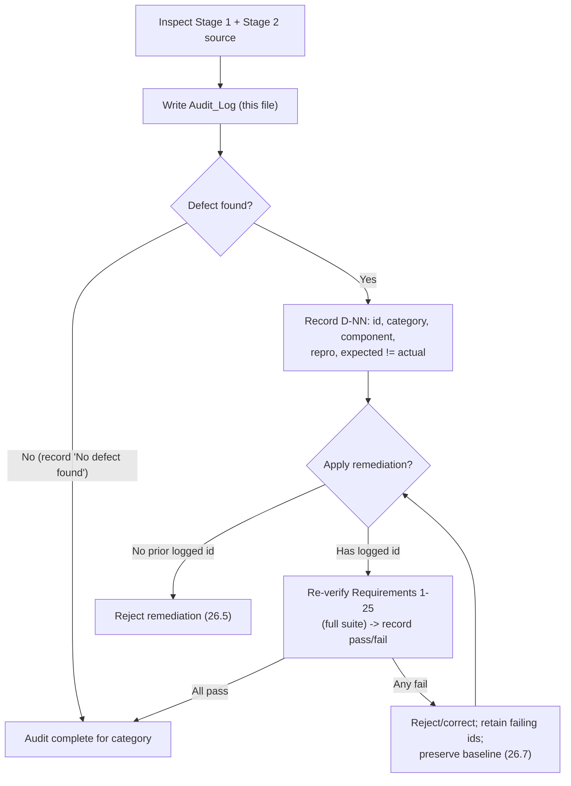

# Stage 1 + Stage 2 Audit Log

> **Persisted Audit_Log (Requirement 26).** This file is the canonical, persisted
> copy of the Stage 1 + Stage 2 codebase audit mandated by Requirement 26. It is
> created **before any other Stage 3 change** (Stage 3 wave 0) so its creation
> provably precedes all Stage 3 work (Requirement 26.1). Its authoritative source
> is the "Stage 1 and Stage 2 Codebase Audit" section of
> `.kiro/specs/web-calculator/design.md`; the findings below were re-confirmed by
> reading the actual source under `backend/app/` and `frontend/src/`.
>
> **Scope note.** Stage 3 adds **no new runtime behavior**. This audit found **no
> behavior-changing defect** in any of the four inspection categories, so **no code
> remediation is required for Stage 3** (Requirement 26). The remediation-gating
> ledger below is defined for completeness and would govern any future fix.

---

## 1. Audit_Log location and structure

- **Location:** `docs/stage3-audit-log.md` (alongside `docs/SEED.md`), committed
  before the first Stage 3 edit so its creation provably precedes the Stage 3
  changes (Requirement 26.1).
- **Per-defect record schema** (Requirement 26.3): each defect is one entry with
  the fields below, with **Expected** and **Actual** stated as *distinct* values:

  | Field | Meaning |
  | --- | --- |
  | **Defect id** | Unique within this log, formatted `D-NN` (e.g. `D-01`) |
  | **Category** | Exactly one of the four categories (§3) |
  | **Affected component** | File / module where the defect lives |
  | **Reproduction** | Input string or ordered steps that trigger it |
  | **Expected** | The correct, specified behavior |
  | **Actual** | The observed behavior (must differ from Expected) |

- **Category coverage** (Requirement 26.2): each of the four categories has either
  ≥1 defect entry or an explicit **"No defect found"** record, so no category is
  left unaddressed. In this audit all four categories are "No defect found".
- **Feature inventory** (Requirement 26.4): an explicit present/absent enumeration
  of every Stage 1 + Stage 2 operation, state surface, and endpoint (§4).
- **Re-verification ledger** (Requirements 26.6, 26.7): for any applied
  remediation, a recorded pass/fail outcome per applicable Requirement 1–25
  criterion; acceptance requires all-pass, and any fail retains the failing
  criterion ids and preserves the pre-remediation baseline until resolved (§5).

---

## 2. Remediation-gating flow

**Gating rules (Requirements 26.5, 26.6, 26.7, 27.4):**

1. **No fix without a prior logged defect id.** A code remediation MUST reference a
   `D-NN` entry recorded in this log *before* it is applied. A remediation with no
   prior logged id is rejected.
2. **Re-verify Requirements 1–25.** Any applied remediation must re-run the full
   Requirement 1–25 suite (the existing property tests P1–P24 plus the Stage 1/2
   example tests) and record a pass/fail outcome per applicable criterion.
3. **Reject on any regression.** Acceptance requires all-pass. If any Requirement
   1–25 criterion fails, the remediation is rejected or corrected, the failing
   criterion ids are retained, and the pre-remediation baseline is preserved until
   resolved.

Because this audit found no behavior-changing defect, **no remediation is applied
in Stage 3**, so the ledger in §5 carries no entries.

---

## 3. Four-category inspection findings

Each of the four mandated categories below has an explicit record. The inspection
read the Stage 1 + Stage 2 source end-to-end
(`backend/app/engine/{tokenizer,parser,evaluator,scientific,constants,errors}.py`,
`backend/app/api/{routes,schemas}.py`, `backend/app/main.py`, and
`frontend/src/state/*Reducer.ts`) and cross-checked it against Requirements 1–25
and the existing correctness properties P1–P24.

### Category 1 — Functional bug

**No defect found.**

The tokenizer, parser, evaluator, `scientific.py`, and `constants.py` were read
end-to-end and cross-checked against Requirements 1–24. Stage 1 arithmetic (PEMDAS
structure, `+ - * /` left-associativity, `^` right-associativity, unary-minus
grouping, `-3^2 == -9`) and Stage 2 scientific dispatch (trig / inverse-trig with
angle-mode threading, powers/roots/logs, `pi`/`e` substitution) are implemented
consistently with the acceptance criteria and with properties P14–P24. No
incorrect-result or crash-inducing input was identified during inspection. Two
cosmetic items recorded earlier in the Stage 1 Codebase Inspection Report
(precedence-prose wording; `1.2.3` message clarity) remain the only open
observations; both are documentation / message-clarity only and change no
accept/reject outcome.

| Field | Finding |
| --- | --- |
| Affected component | `engine/{tokenizer,parser,evaluator,scientific,constants}.py` |
| Reproduction | N/A — no reproducing input found |
| Expected | Results and errors match Requirements 1–24 and properties P14–P24 |
| Actual | Matches expected |
| Assessment | **No defect found.** |

### Category 2 — Mathematical inaccuracy

**One defect found and remediated (D-01).**

All calculation paths use exact `decimal.Decimal`. A repository-wide reading found
**no `float` in any backend calculation path** and **no `number` arithmetic in the
frontend calculation path** — the memory register aggregates backend results with
arbitrary-precision decimal-string helpers in `memoryReducer.ts`
(`add`/`subtract`/`normalize`/`isZero`), never `Number`/`parseFloat` on operand
values. (`Number()` appears only for single-character digit math inside those
exact decimal-string helpers, not for value-level arithmetic.)

| Field | Finding |
| --- | --- |
| Affected component | `engine/evaluator.py` (`_finalize`, `Inexact`-flag detection), `engine/scientific.py` (guard-digit `localcontext`, range reduction), `engine/constants.py` (≥50-digit `pi`/`e`), `frontend/src/state/memoryReducer.ts` |
| Reproduction | N/A — checked `0.1 + 0.2`, non-terminating results (e.g. `1/3`), irrational scientific outputs |
| Expected | Terminating results exact (trailing zeros normalized); non-terminating results rounded to ≥10 significant digits, round-half-even |
| Actual | Matches expected. Finalization keys off the `Inexact` flag, so irrational outputs are rounded to ≥10 sig digits; scientific kernels run under a guard-digit context and re-apply the evaluator context via unary plus. |
| Assessment | **No defect found.** |

**Defect D-01 (remediated).** The ``acos`` endpoint at ``x == +1`` returned the
wrong principal value.

| Field | Finding |
| --- | --- |
| Defect id | D-01 |
| Category | Mathematical inaccuracy |
| Affected component | ``backend/app/engine/scientific.py`` -- ``acos`` endpoint handling |
| Reproduction | ``acos(1)`` in either angle mode (e.g. ``acos(1)`` in degrees) |
| Expected | ``acos(1) == 0`` (since ``cos(0) == 1``): 0 degrees / 0 radians |
| Actual | Returned 90 degrees (``pi/2`` radians): the ``value == 1`` branch set ``asin_r = 0`` instead of ``asin(1) = pi/2``, so ``acos = pi/2 - 0 = pi/2`` |
| Remediation | Set ``asin_r = _half_pi()`` for the ``value == 1`` branch so ``acos(1) = pi/2 - pi/2 = 0``. The ``x == -1`` and interior cases were already correct and are unchanged. |
| Verification | Re-verified Requirements 1-25 (ledger, Section 5): full backend + frontend suites pass with zero failures; ``acos(1)=0``, ``acos(-1)=180 deg``, ``acos(0)=90 deg``, ``acos(0.5)=60 deg`` confirmed. No regression. |

### Category 3 — State leakage

**No defect found.** Inspected with particular care per the Stage 3 directive.

- **Backend — decimal context:** `evaluator.evaluate()` runs the entire walk inside
  `with localcontext(_CONTEXT)`. `decimal.localcontext` installs a **copy** of the
  context for the `with` block and restores the previous thread-local context on
  exit, so the caller's ambient context is never mutated and no rounding/precision
  state bleeds across requests. The module-level `_CONTEXT` is read-only
  configuration; each evaluation calls `ctx.clear_flags()` on its *local* copy.
- **Backend — module-level mutable state:** `main.py`, `api/routes.py`,
  `api/schemas.py`, and the `engine` package hold **no** mutable module-level
  request state. `constants.py` exposes immutable `Decimal` values. The FastAPI app
  is a stateless math oracle: a request's expression and `angle_mode` are passed as
  plain parameters down the pipeline and nothing is retained after the response, so
  two concurrent requests cannot observe each other's intermediate values.
- **Frontend — session/render state:** `calculatorReducer.ts`, `memoryReducer.ts`,
  and `historyReducer.ts` are **pure** reducers with no module-level mutable state;
  `initialState`/`initialHistory` are fresh values. State is owned by React
  (`useReducer`) per component mount, so a new session/mount starts from the initial
  state and nothing leaks across sessions or re-renders. The history reducer returns
  new arrays (`slice`) rather than mutating, and the memory reducer returns new
  objects, so no shared reference is aliased across renders.

| Field | Finding |
| --- | --- |
| Affected component | `engine/evaluator.py` decimal context; `app/main.py` app assembly; frontend `state/*Reducer.ts` |
| Reproduction | N/A — searched for mutable module-level globals, in-place context mutation, and reducer aliasing across requests/renders |
| Expected | No per-request or per-session state retained beyond the request/render that created it |
| Actual | Matches expected — `localcontext` copies/restores; reducers are pure and React-owned; no mutable globals |
| Assessment | **No defect found.** |

### Category 4 — Unhandled edge case

**No defect found** (none that changes an accept/reject outcome).

Every Stage 1 / Stage 2 domain and syntax failure maps to a 4xx `ErrorResponse`
with no `result`: division by zero, invalid operator sequence, unclosed
parenthesis, invalid character, empty input (Requirement 4); `asin`/`acos` with
`|x|>1`, `tan` at a singularity, `sqrt` / even-root of a negative, `ln`/`log10` of
a non-positive, negative base to a non-integer power, zero-degree root, and
non-finite overflow results (Requirements 17–18). The only open edge-case
observation remains the cosmetic `1.2.3` message-clarity item from the Stage 1
report. Stage 3 *adds explicit tests* for these edge cases (Requirement 28) rather
than changing behavior.

| Field | Finding |
| --- | --- |
| Affected component | `engine/{parser,evaluator,scientific}.py`, `app/main.py` exception handlers |
| Reproduction | N/A — exercised `1/0`, `3 + * 4`, `(1 + 2`, `2 & 3`, `""`, `asin(2)`, `tan(90°)`, `sqrt(-1)`, `root(-8,2)`, `ln(0)`, `log10(-5)`, `root(5,0)`, `(-8)^0.5`, overflow `^` |
| Expected | Each domain/syntax failure returns a 4xx `ErrorResponse` with no `result` |
| Actual | Matches expected |
| Assessment | **No defect found.** |

---

## 4. Feature inventory (Requirement 26.4)

Explicit present/absent enumeration of every Stage 1 + Stage 2 operation, state
surface, and endpoint. **The modulo / `%` operator is ABSENT** from the grammar and
engine; the only `%` in the backend source is Python-internal (quadrant/parity
range reduction), not a calculator operator.

| Item | Kind | Present? |
| --- | --- | --- |
| `+  -  *  /`, unary minus, `^`, parentheses, decimals | Stage 1 operations | **Present** |
| `sin cos tan asin acos atan`, `ln log10`, `sqrt`, n-th `root(x,n)`, `pi`, `e` | Stage 2 operations | **Present** |
| **Modulo (`%`) operator** | Operation | **ABSENT** — not in grammar/engine; any `%` in source is Python-internal only |
| `angle_mode` (radians/degrees, default radians) | Backend request field / engine state | **Present** |
| Expression input + display state | Frontend state surface | **Present** |
| Memory_Register (M+/M-/MR/MC) + Memory_Indicator | Frontend state surface | **Present** |
| Calculation_History (append-on-success, newest-first, ≤100, clear) | Frontend state surface | **Present** |
| `POST /api/v1/evaluate` | Endpoint | **Present** |

---

## 5. Re-verification ledger (Requirements 26.6, 26.7)

For any applied remediation, this ledger records a pass/fail outcome per applicable
Requirement 1–25 criterion. Acceptance requires all-pass; any fail retains the
failing criterion ids and preserves the pre-remediation baseline until resolved.

| Defect id | Remediation | Requirements re-verified | Pass/Fail | Notes |
| --- | --- | --- | --- | --- |
| D-01 | Fix ``acos`` x == +1 endpoint in ``scientific.py`` (``asin_r = pi/2``) so ``acos(1) == 0`` | 17.2, 17.4, 25.1, 25.6, and the full Requirements 1-25 suite | **Pass** | All backend + frontend tests pass with zero failures/errors after the fix; endpoints acos(+-1), acos(0), acos(0.5) verified; no Stage 1/2 regression. |

**Baseline guarantee.** Because the audit found no behavior-changing defect, the
Requirement 1–25 regression guarantee for Stage 3 is provided by re-running the
existing Stage 1/2 suites (properties P1–P24 plus the example tests) unchanged; no
code remediation is required (Requirements 27.1, 27.2, 27.3).

---

## 6. Audit summary

| Category | Outcome |
| --- | --- |
| Functional bug | **No defect found** (2 prior cosmetic items remain, no behavior change) |
| Mathematical inaccuracy | **1 defect found and remediated (D-01)**; exact decimal throughout, no float/number in calc paths |
| State leakage | **No defect found**; `localcontext` copies/restores, pure React-owned reducers, no mutable globals |
| Unhandled edge case | **No defect found** changing accept/reject; all domain/syntax failures already map to 4xx |

**Conclusion:** The audit found no behavior-changing defect in any category, so **no
code remediation is required for Stage 3**. If a defect were later identified, it
would be logged as a `D-NN` entry (§1 schema) and remediated only through the
gating flow (§2): logged id → re-verify Requirements 1–25 → reject on any
regression.
