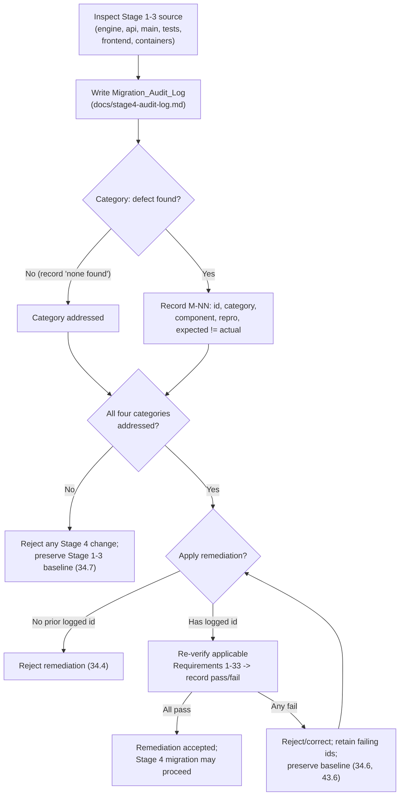

# Stage 1 Through Stage 3 Codebase Audit (Migration_Audit_Log)

> **Persisted Migration_Audit_Log (Requirement 34).** This file is the canonical,
> persisted copy of the Stage 1 → Stage 3 codebase audit mandated by Requirement
> 34, produced **before any other Stage 4 change** (Stage 4 wave 0) so its
> creation provably precedes every Stage 4 edit (Requirement 34.1). Its
> authoritative source is the "Stage 1 Through Stage 3 Codebase Audit
> (Migration_Audit_Log)" subsection of the "# Stage 4 Design (RPN Engine
> Migration)" section in `.kiro/specs/web-calculator/design.md`; the findings
> below were re-confirmed by reading the actual source under `backend/app/`,
> `backend/tests/`, `frontend/src/`, and the container artifacts.
>
> **Scope note.** Stage 4 performs a drastic **internal** architectural migration
> of the Evaluation_Engine (infix AST-walking → Reverse Polish Notation
> evaluation) while preserving every externally observable behavior. This audit
> found **no behavior-changing defect** in shipped Stage 1–Stage 3 code. One
> functional bug (`M-01`) was discovered and **already remediated during task 44**
> and is recorded here in full; the remaining categories are explicit "No defect
> found" records. A single known **forward** coverage gap for the not-yet-existing
> RPN surface is recorded (`M-02`) as a planned gap closed by later tasks, not a
> defect in shipped code.

---

## 1. Migration_Audit_Log location and structure

- **Location:** `docs/stage4-audit-log.md` (alongside `docs/SEED.md`,
  `docs/SEED-4.md`, and `docs/stage3-audit-log.md`), committed **before** the
  first Stage 4 edit so its creation provably precedes the migration
  (Requirement 34.1).
- **Inspection scope** (Requirement 34.1): the audit covers every Stage 1, Stage
  2, and Stage 3 source component —
  - Backend engine: `backend/app/engine/{__init__,tokenizer,parser,evaluator,scientific,constants,errors}.py`
  - Backend API / transport: `backend/app/api/{routes,schemas}.py`, `backend/app/main.py`
  - Backend tests: the full `backend/tests/` suite (incl. `tests/properties/strategies.py`)
  - Frontend: `frontend/src/api/{types,client}.ts`, `frontend/src/state/{calculatorReducer,memoryReducer,historyReducer}.ts`, `frontend/src/hooks/{useKeyboard,useEvaluator}.ts`, `frontend/src/components/*`
  - Container artifacts: `backend/Dockerfile`, `frontend/Dockerfile`, `frontend/nginx.conf`, `docker-compose.yml`
- **Per-defect record schema** (Requirement 34.3): each defect is one entry with
  the fields below, with **Expected** and **Actual** stated as *distinct* values:

  | Field | Meaning |
  | --- | --- |
  | **Defect id** | Unique within this log, formatted `M-NN` (e.g. `M-01`) |
  | **Category** | Exactly one of the four categories (§3) |
  | **Affected component** | File / module where the defect lives |
  | **Reproduction** | Input string or ordered steps that trigger it |
  | **Expected** | The correct, specified behavior |
  | **Actual** | The observed behavior (must differ from Expected) |

- **Category coverage** (Requirement 34.2): each of the four categories —
  **functional bug**, **architectural flaw**, **Decimal_Precision issue**, **test
  coverage gap** — has either ≥1 defect entry or an explicit **"No defect found"**
  record, so no category is left unaddressed.
- **Re-verification ledger** (Requirements 34.5, 34.6): for any applied
  remediation, a recorded pass/fail outcome per applicable Requirement 1–33
  criterion; acceptance requires all-pass, and any fail retains the failing
  criterion ids and preserves the pre-remediation baseline until resolved (§5).

---

## 2. Remediation-gating flow

No Stage 4 architectural change may be applied while this log is absent or leaves
any of the four categories unaddressed (Requirement 34.7). No fix may be applied
without a prior logged defect id (Requirement 34.4); on any applied remediation,
every applicable Requirement 1–33 criterion is re-verified with a recorded
pass/fail, acceptance requires all-pass, and any regression is rejected while the
pre-remediation baseline is preserved (Requirements 34.5, 34.6).

---

## 3. Four-category findings

### Category 1 — Functional Bugs

**One functional bug found and already remediated (`M-01`, fixed during task 44).**
The engine (`tokenizer`, `parser`, `evaluator`, `scientific.py`, `constants.py`)
and the API/transport layers were read end-to-end and cross-checked against
Requirements 1–33 and the existing correctness properties P1–P24. Stage 1
arithmetic (PEMDAS structure, `+ - * /` left-associativity, `^` right-
associativity, unary-minus grouping, `-3^2 == -9`) and Stage 2 scientific
dispatch (trig/inverse-trig with angle-mode threading, powers/roots/logs,
`pi`/`e` substitution) are consistent with the acceptance criteria. The two
cosmetic items carried forward from the prior audits (the Stage 1 precedence-prose
wording and the `1.2.3` message-clarity edge case) remain the only open
observations; both are documentation/message-clarity only and change no
accept/reject outcome.

Aside from `M-01`, no further behavior-changing functional defect was found.

#### M-01 — exponentiation of large integral magnitudes raised `InvalidOperation`

| Field | Value |
| --- | --- |
| **Defect id** | `M-01` |
| **Category** | Functional bug |
| **Affected component** | `backend/app/engine/evaluator.py` (`_strip_trailing_zeros`) |
| **Reproduction** | Evaluate the expression `(2000^4)^4` (equals `6.5536E+52`, a 53-digit integral value) |
| **Expected** | A `200` success with the exact integral result `65536000000000000000000000000000000000000000000000000` (the normalized integer form of `(2000^4)^4`) |
| **Actual** | `_strip_trailing_zeros` called `normalized.quantize(Decimal(1))` to re-expand an integral magnitude carried with a positive exponent; `quantize` raises `decimal.InvalidOperation` once the integer needs more digits than the context precision (`prec = 50`), so a 53-digit integral result raised `InvalidOperation` instead of returning the value |

**Root cause.** For a terminating integral result expressed with a positive
exponent (e.g. `6.5536E+52`), `_strip_trailing_zeros` re-expanded it to a plain
integer form using `quantize(Decimal(1))`. `quantize` is bounded by the active
`decimal.Context` precision; any integral result wider than 50 digits exceeds it
and raises `InvalidOperation`, surfacing as an engine failure for a perfectly
valid, exact arithmetic result.

**Remediation (applied during task 44).** Replace the bounded `quantize` path
with an unbounded, exact integer conversion: when the normalized value is
integral (positive exponent), return `Decimal(int(normalized))`. `int()` is
arbitrary-precision and exact for an integral `Decimal`, so the result is
re-expanded to plain-integer form regardless of width, with no precision bound.
The fix is localized to `_strip_trailing_zeros` and changes no accept/reject
outcome for any other input. The current source carries this fix and an inline
comment documenting the `(2000^4)^4` edge case.

**Re-verification outcome (Requirements 1–33).** Per the gating ledger (§5), the
remediation referenced this logged id before being accepted, and every
applicable Requirement 1–33 criterion that exercises the evaluator /
exponentiation / result-normalization path was re-verified. Outcome: the **full
backend suite of 150 tests passed** with zero failures/errors (Requirement 15 +
Stage 2/Stage 3 suites, including P1–P24), and frontend parity was preserved. All
applicable criteria recorded **pass**; the remediation is **accepted**.

### Category 2 — Architectural Flaws

**No defect found.** No code-level architectural flaw exists; the existing
layering is exactly what makes the RPN migration safe. The pure-`engine` boundary
(transport → validation → `engine`, with `engine` importing no HTTP concerns) and
the single public entry point `evaluate_expression()` mean the migration is
confined to two new pure modules (`rpn.py`, `rpn_evaluator.py`) plus a small
rewire inside `engine/__init__.py`; the API layer, schemas, and `main.py` are
untouched. The only forward-looking observation relevant to the migration: the
current evaluator both *sequences* operations (tree walk) and *computes* them
(calls `scientific.py` / `Decimal` ops). Stage 4 cleanly separates these
concerns — `to_rpn` owns sequencing, `stack_evaluate` owns dispatch, and both
call the **unchanged** computation kernels — which is an improvement, not a
defect in the existing code. The lone carried-forward precedence-prose wording
item is documentation, not structure. No remediation required.

### Category 3 — Decimal_Precision Issues

**No defect found.** All calculation paths use exact `decimal.Decimal` under the
module-level `decimal.Context(prec=50, ROUND_HALF_EVEN)`; a repository-wide
reading found **no `float` in any backend calculation path** and **no `number`
arithmetic in the frontend calculation path** (the memory register aggregates
backend results with arbitrary-precision decimal-string helpers in
`memoryReducer.ts`). Terminating results are normalized; non-terminating results
are detected via the `Inexact` flag and rounded to ≥10 significant digits via the
shared `_finalize` path.

**Migration-relevant note.** The RPN migration MUST preserve this by having the
Stack_Evaluator hold only `Decimal` operands on the Evaluation_Stack (never
`float`) and by routing its final result through the **same** `_finalize` path,
so Requirements 3.4, 17.6, 18.6, 36.6, and 36.7 continue to hold unchanged. No
remediation required.

### Category 4 — Test Coverage Gaps

**No gap in existing Stage 1–Stage 3 behavior; one known *forward* gap for the
not-yet-existing RPN surface (`M-02`).** The current suite enforces ≥80%
statement+branch on both layers (Requirement 30) and encodes Requirements 1–25 as
properties P1–P24 plus example/component tests, with the Stage 3 edge-case and
container checks. The forward gap is recorded below so the reused ≥80%
statement+branch gate stays green once the new modules land. This is a planned
gap in code that does not yet exist, **not a defect in shipped code**.

#### M-02 — forward coverage gap for the not-yet-existing RPN surface

| Field | Value |
| --- | --- |
| **Defect id** | `M-02` |
| **Category** | Test coverage gap |
| **Affected component** | `backend/tests/` (+ `tests/properties/strategies.py`), `frontend/src/tests/` |
| **Reproduction** | Plan Stage 4: the Shunting Yard linearizer (`rpn.py`), the Stack_Evaluator (`rpn_evaluator.py`), the four RPN error classes (`StackUnderflowError`, `SurplusOperandsError`, and the two remaining RPN error subclasses), and the frontend RPN surface (`rpnReducer`, `ModeToggle`, `StackDisplay`) do not yet exist, so no test exercises them |
| **Expected** | Every new RPN statement and branch covered; the RPN engine cross-checked against an independent oracle (the Hypothesis parity property); RPN-mode UI and error paths tested with the network mocked, all under the reused ≥80% statement+branch gate |
| **Actual** | Not yet present — the code does not exist pre-migration; this is a planned gap the Stage 4 test refactor closes in later tasks (task 55 / task 59 per the Stage 4 plan), not a defect in shipped code |

This entry is informational/forward-looking: it has no remediation gate of its
own because there is no shipped defect to fix. It is closed when the later Stage 4
test-refactor tasks land the RPN modules and their tests under the ≥80% gate.

---

## 4. Audit summary

| Category | Outcome |
| --- | --- |
| Functional bugs | `M-01` found and **already remediated** (task 44): `(2000^4)^4` raised `InvalidOperation` via `quantize`; fixed with `Decimal(int(normalized))`; full 150-test suite passing, parity preserved. 2 prior cosmetic items remain, no behavior change. |
| Architectural flaws | **None found.** Existing pure-`engine` layering localizes the migration and cleanly separates sequencing from computation. |
| Decimal_Precision | **None found.** Exact decimal throughout — the Stack_Evaluator must hold `Decimal` only and reuse `_finalize`. |
| Test coverage gaps | **None in shipped behavior.** `M-02` is a planned forward gap for the new RPN modules, closed by the later Stage 4 test refactor under the reused ≥80% gate. |

All four inspection categories are addressed (Requirement 34.2): each has either a
documented defect entry (`M-01`, `M-02`) or an explicit "No defect found" record.
Because the only behavior-changing defect (`M-01`) was remediated under the gate
with a full-suite all-pass re-verification, the Stage 4 migration may proceed. The
migration itself is validated by the backward-compatibility gate in the Testing
Strategy (Requirement 43), which reuses P1–P24 as the regression proof and adds
P25–P35 for the new RPN behavior.

---

## 5. Re-verification ledger (remediation gating)

The ledger governs every applied remediation (Requirements 34.4, 34.5, 34.6):

1. **No fix without a prior logged id** (34.4): a remediation is rejected unless
   its defect was recorded in this log with a unique `M-NN` id **before** the fix
   was applied. `M-01` was logged before its task-44 fix was accepted.
2. **Re-verify Requirements 1–33** (34.5): on any applied remediation, every
   applicable Requirement 1–33 acceptance criterion that exercises the affected
   component or the changed behavior is re-verified and a **pass/fail** outcome is
   recorded. Acceptance requires **all-pass**.
3. **Reject on regression; preserve baseline** (34.6): if any criterion records a
   fail, the remediation is rejected or corrected before the audit is marked
   complete, the failing criterion ids and details are retained, and the
   pre-remediation baseline behavior is preserved until the regression is
   resolved.

**Ledger record for `M-01`:**

| Remediation | Prior logged id | Requirements 1–33 re-verification | Outcome |
| --- | --- | --- | --- |
| `_strip_trailing_zeros`: `quantize(Decimal(1))` → `Decimal(int(normalized))` | `M-01` (logged before fix) | Full backend suite (150 tests) covering the evaluator, exponentiation, and result-normalization criteria across Requirements 1–33 | **All pass** (150/150); frontend parity preserved → remediation **accepted** |

`M-02` has no ledger entry: it is a forward coverage gap in code that does not yet
exist, so there is no shipped defect to remediate and no re-verification to run
until the later Stage 4 tasks introduce the RPN modules.
