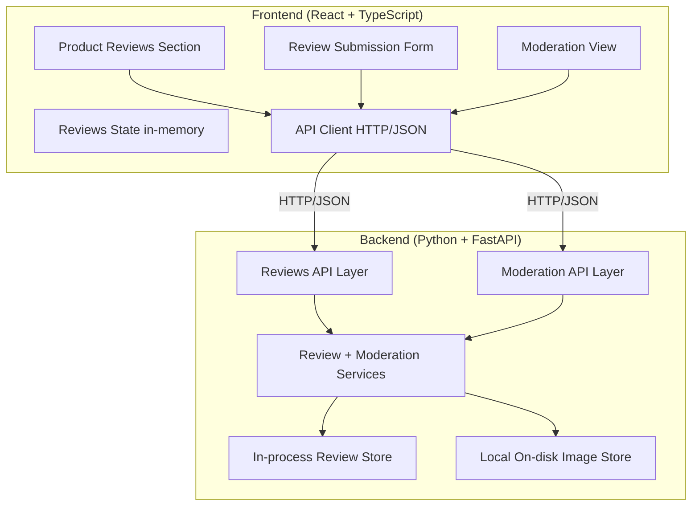

# Design Document

## Overview

Stage 2 adds **product reviews with images and moderation** to the existing Stage 1 demonstration e-commerce application, without changing the Stage 1 purchasing journey. The design is intentionally minimal and additive: it introduces new backend endpoints, new backend service/data/model modules, and new frontend views and state, all following the layering, naming, and testing conventions already established in Stage 1.

The feature has three cooperating flows:

1. **Submission** — a signed-in Customer submits a Review (rating, text, optional title, 0–3 images) for a Product. The Review is created in Moderation_State `pending`.
2. **Moderation** — a signed-in Moderator sees the Moderation_Queue of `pending` reviews and approves or rejects each one. Decisions are terminal.
3. **Display** — any person viewing a Product sees only `approved` reviews and an aggregate Rating_Summary. Attached images are served from the backend.

The split between a React + TypeScript frontend (presentation) and a Python + FastAPI backend (business logic and data) is preserved. The two sides communicate over the existing HTTP/JSON interface. Every decision the seed delegated is fixed by an Assumption (A1–A8) in `requirements.md` and is honored here.

### Scope Boundaries Honored

Not designed, matching the requirements' Scope Restrictions: helpfulness voting/replies/threads, author edit/delete, extra moderation states or un-rejecting, automated/AI moderation or profanity filtering, external object storage/CDN/transcoding/paid image services, durable databases or production infrastructure, purchase-verified reviews, email notifications or audit logs beyond in-memory state, moderator-management UIs, and any change to the Stage 1 endpoints, credential contract, or journey beyond surfacing reviews on the product view.

### Requirement Coverage Summary

| Requirement | Addressed by |
| --- | --- |
| R1 Submit a review | Review submission form, `POST /products/{id}/reviews`, review service validation, `Review` model |
| R2 Attach images | Image fields in submission, local image store, `GET /reviews/images/{imageId}`, image validation |
| R3 Moderation workflow | Moderation view, `GET /moderation/reviews`, `POST /moderation/reviews/{id}/approve`\|`/reject`, moderator session guard |
| R4 View approved + rating summary | Product reviews section, `GET /products/{id}/reviews`, Rating_Summary aggregation |
| R5 Author identity + immutability | `authorIdentity` on `Review`, no edit/delete endpoints, non-sensitive identity only |
| R6 Secure/safe handling | Structured safe errors, text rendered as text (React default), image-type allow-list, moderator guard |
| R7 Feedback and states | Loading/invalid/error/empty states across review and moderation views |
| R8 Usable/accessible interface | Responsive layout, labeled controls, label-field association, image alt text |
| R9 Technology/architecture/language | React+TS additions, FastAPI additions, layer separation, in-process store, English artifacts |

## Architecture

### High-Level Structure

Stage 2 keeps the Stage 1 two-part architecture and extends each side additively.



This preserves Requirement 9: UI separated from server logic (R9.3), presentation/business/data separation on the backend (R9.4), and a project that still runs and is reviewed as two parts.

### Layering Rationale

- **API layer (FastAPI routers):** New routers `app/api/reviews.py` (public + authoring endpoints) and `app/api/moderation.py` (moderator-only endpoints) validate request shape, enforce the session/moderator guard, and map service outcomes to JSON with appropriate status codes. They contain no business logic and never touch the stores directly.
- **Service layer:** `app/services/review_service.py` holds submission validation (rating range, text/title length, one-per-customer-per-product), image validation (count, type, size), review creation with `pending` state, the Moderation_Queue read, approve/reject transitions (terminal), the public approved-reviews read, and Rating_Summary aggregation.
- **Data-access layer:** `app/data/reviews.py` is an in-process `ReviewStore` mirroring the Stage 1 `AccountStore` style (in-memory dict keyed by review id, returning copies). `app/data/review_images.py` is a local on-disk `ImageStore` that writes validated image bytes to `backend/app/data/review_images/` and reads them back for serving (Assumption A3, A6).
- **Moderator identity (A5):** Moderator accounts live in the Stage 1 `AccountStore`, distinguished by a boolean `is_moderator` added to the `Customer` model (default `False`, so existing accounts and the Stage 1 contract are unchanged). A single demonstration moderator is seeded at startup. The sign-in service is extended so the established `Session` records whether the signed-in account is a moderator; the moderation router consults that session flag.

### Session Extension (reuse of Stage 1)

Stage 1 keeps a single module-level `Session` in `signin_service.py`. Stage 2 reuses that exact mechanism and adds a derived capability flag: the `Session` gains an `is_moderator` field (default `False`). `sign_in` sets it from the authenticated account. The moderation router calls `get_current_session()` and denies the request (401/403) when there is no active session or the active session is not a moderator (R3.6, R6.4). This avoids inventing a parallel auth system and stays consistent with Stage 1.

### Data Store Choice

Review records are held in the in-process `ReviewStore` for the lifetime of the backend process, matching Stage 1's demonstration store (R9.6, Assumption A6). Image **bytes** are the single on-disk artifact: validated bytes are written to a git-ignored local folder and served through `GET /reviews/images/{imageId}` (Assumption A3). No external storage, CDN, or paid service is involved (R2.7). Metadata about each image (id, review id, media type, stored filename) lives alongside the review in the in-process store.

### Project Structure (additions only)

```
/backend
  app/
    api/
      reviews.py          # NEW: submission + public reviews + image serving
      moderation.py       # NEW: moderator-only queue + approve/reject
    services/
      review_service.py   # NEW: review + moderation business logic
      moderator_seed.py   # NEW: seed the demonstration moderator account
    data/
      reviews.py          # NEW: in-process ReviewStore
      review_images.py    # NEW: local on-disk ImageStore
      review_images/       # NEW: git-ignored folder for stored image bytes
    models/
      review.py           # NEW: Review, ReviewImage, submission/response models
/frontend
  src/
    state/
      reviews.ts          # NEW: pure review/rating-summary helpers
      ReviewsState.tsx    # NEW (optional): reviews fetching hook/context
    views/
      ProductReviews.tsx  # NEW: approved reviews + rating summary on a product
      ReviewForm.tsx      # NEW: submission form with image attach
      ModerationView.tsx  # NEW: moderator queue + approve/reject
```

Stage 1 files are extended only where additive integration is required: `app/models/customer.py` (+`is_moderator`), `app/models/session.py` (+`is_moderator`), `app/services/signin_service.py` (set the flag), `app/main.py` (include new routers, seed moderator, mount nothing external), `frontend/src/types.ts` (+review types), `frontend/src/api/client.ts` (+review methods), and the product view/App shell to surface reviews and a moderation entry point.

## Components and Interfaces

### Frontend Components

All user-facing text and identifiers are in English (R9.7).

- **ProductReviews** — For a given Product, loads and displays the approved reviews and the Rating_Summary (R4.1, R4.3). Shows each review's rating (as stars/number), optional title, text (rendered as text, R6.2), author identity (non-sensitive, R5.4), and attached images with descriptive alt text (R2.6, R8.4). Shows an empty state when there are no approved reviews (R4.4). Renders loading and error states (R7.1, R7.3).
- **ReviewForm** — Visible only when a (non-moderator) Customer has an active Session (R1.1); when no session is active it shows an identification prompt instead of the form (R1.2). Collects rating (1–5), optional title, required text, and up to 3 image attachments (R1.3–R1.5, R2.1). Performs client-side validation mirroring the backend and surfaces field-level errors (R7.2). On success shows a confirmation that the review awaits moderation (R1.9) and prevents a second submission for the same product (R1.8 surfaced from the backend).
- **ModerationView** — Visible only when a Moderator has an active moderator Session; otherwise it shows that moderator access is required (R3.6). Loads the Moderation_Queue (R3.1), displays each pending review's product, rating, text, images, and author (R3.2), and provides Approve and Reject controls (R3.3, R3.4) with a visible decision confirmation (R3.8). Approved/rejected reviews leave the queue (R3.5). Shows an empty state when the queue is empty (R7.4).

### Frontend State

A small set of pure helpers in `state/reviews.ts` computes the Rating_Summary (count and average) from a list of reviews, with stable rounding, so the display logic is testable without the DOM. Reviews are fetched on demand per product and for the moderation queue; they are not part of the Stage 1 cart/session journey state and do not alter it (R9.5).

### Backend Service Layer

`review_service.py` exposes:

- `submit_review(product_id, author_identity, rating, text, title, images)` → `Review` — validates eligibility and fields (R1.2–R1.8, R2.1–R2.4), stores images (R2.5), creates the review as `pending` (R1.7), records author identity (R5.1). Raises structured errors (`ReviewValidationError`, `DuplicateReviewError`, `ReviewAuthError`).
- `list_pending_reviews()` → `list[Review]` — the Moderation_Queue (R3.1).
- `approve_review(review_id)` / `reject_review(review_id)` → `Review` — terminal transitions from `pending` (R3.3, R3.4, R3.7); raise if already decided or unknown.
- `list_approved_reviews(product_id)` → `list[Review]` — Visible_Reviews only (R4.1, R4.2).
- `rating_summary(product_id)` → `{ count, average }` from approved ratings only (R4.3, R4.5).

Validation never includes submitted credential values and errors carry only safe, client-facing messages (R6.1).

### Backend Image Handling

`review_images.py` validates and stores image bytes:
- Input images arrive base64-encoded with a declared media type (Assumption A3). The store decodes, checks the media type against the allow-list (`image/jpeg`, `image/png`, `image/gif`, `image/webp`), checks the decoded size against the 2 MB cap, and only then writes bytes to the local folder with a generated filename (R2.3, R2.4, R6.3). Rejected attachments are never written.
- `GET /reviews/images/{image_id}` streams the stored bytes with the recorded media type (R2.7). Unknown ids return a structured 404.

### API Interface (Frontend ↔ Backend)

All field names and messages are in English (R9.7); request/response bodies use the models below and camelCase JSON, consistent with Stage 1. New endpoints:

| Method | Path | Purpose | Auth | Requirements |
| --- | --- | --- | --- | --- |
| `GET` | `/products/{id}/reviews` | List approved reviews + rating summary for a product. | none | R4.1, R4.3, R4.4, R4.5 |
| `POST` | `/products/{id}/reviews` | Submit a review (rating, text, title?, images?). | customer session | R1.1–R1.9, R2.1–R2.5 |
| `GET` | `/reviews/images/{imageId}` | Serve a stored review image's bytes. | none | R2.6, R2.7 |
| `GET` | `/moderation/reviews` | List the pending moderation queue. | moderator session | R3.1, R3.2, R7.4 |
| `POST` | `/moderation/reviews/{reviewId}/approve` | Approve a pending review. | moderator session | R3.3, R3.5, R3.7, R3.8 |
| `POST` | `/moderation/reviews/{reviewId}/reject` | Reject a pending review. | moderator session | R3.4, R3.5, R3.7, R3.8 |

Interface behavior notes:

- `POST /products/{id}/reviews` requires an active, non-moderator customer session; an unauthenticated request is rejected with a structured authentication error (R1.2, R6.1). It validates the rating range, text/title lengths, and image count/type/size; on any failure it returns a structured error identifying the offending field(s) without echoing credentials or internals (R1.3–R1.5, R2.2–R2.4, R6.1). A duplicate (same author + product) returns a conflict with a one-per-product message (R1.8). On success it returns the created review with `moderationState: "pending"` (R1.7).
- `GET /products/{id}/reviews` returns only `approved` reviews and a `summary` object `{ count, average }` computed from those reviews (R4.2, R4.5); for an author's own submission the response may include the author's own review with its true state so the author can see it (R4.6) — this author-scoped item is separate from the public list and only present when the requesting session authored a non-approved review.
- Moderation endpoints consult the active session; without an active moderator session they deny the action (R3.6, R6.4). Approve/reject act only on a `pending` review; acting on an already-decided or unknown review returns a structured error and performs no state change (R3.7).

## Data Models

All backend models use English identifiers and serialize camelCase to the HTTP/JSON interface, matching Stage 1 (`ConfigDict(alias_generator=to_camel, populate_by_name=True)`).

### ReviewImage (backend-owned)

```
ReviewImage
  id: string            # stable image identity; used in GET /reviews/images/{id}
  media_type: string    # one of image/jpeg, image/png, image/gif, image/webp
  filename: string      # generated local filename under review_images/
```

The raw bytes are not part of the model; they live on disk and are streamed by the image endpoint. The response surfaces an `imageUrl` derived from the id (`/reviews/images/{id}`) for direct use by ``.

### Review (backend-owned)

```
Review
  id: string                    # stable review identity
  product_id: string            # references Product.id (Stage 1 identity)
  author_identity: string       # the authoring account's identifier (non-sensitive, R5.1, R5.4)
  rating: integer               # 1..5 (Assumption A2)
  title: string | null          # optional, <= 120 chars
  text: string                  # required, 1..2000 chars after trim
  images: list[ReviewImage]     # 0..3 attached images (Assumption A3)
  moderation_state: "pending" | "approved" | "rejected"   # (Assumption A4)
```

No password or credential value is ever placed on a `Review` (R5.4). The model carries no editable surface; there is no update/delete path (R5.2, R5.3).

### ReviewImageInput (request input only)

```
ReviewImageInput
  media_type: string    # declared type, validated against the allow-list
  data_base64: string   # base64-encoded image bytes (Assumption A3)
```

### ReviewSubmission (request input)

```
ReviewSubmission
  rating: integer
  text: string
  title: string | null
  images: list[ReviewImageInput]   # 0..3
```

### ReviewResponse / ReviewSummaryResponse (response output)

```
ReviewResponse
  id, productId, authorIdentity, rating, title, text,
  images: [{ id, imageUrl, mediaType }], moderationState

ProductReviewsResponse
  reviews: list[ReviewResponse]     # approved only (public)
  summary: { count: integer, average: number }   # from approved ratings
  ownReview: ReviewResponse | null  # the requester's own non-approved review, if any (R4.6)
```

### Customer (Stage 1 model, extended additively)

```
Customer
  id, identifier, password_hash       # unchanged from Stage 1
  is_moderator: boolean = False       # NEW: distinguishes moderator accounts (A5)
```

The default `False` keeps the Stage 1 credential contract and existing behavior intact (R9.5).

### Session (Stage 1 model, extended additively)

```
Session
  active: boolean                      # unchanged
  customer_id: string | null           # unchanged
  is_moderator: boolean = False        # NEW: drives the moderation guard (A5)
```

## Correctness Properties

*A property is a characteristic that should hold across all valid executions. Each property below is universally quantified and references the requirements it validates. Properties cover the pure, input-dependent logic of Stage 2 (validation, state transitions, visibility, and aggregation). UI feedback events, static notices, responsive layout, accessibility naming, and image streaming are covered by example, unit, and integration tests in the Testing Strategy instead.*

### Property 1: Review submission validation rejects and identifies all offending fields

*For any* review submission in which the rating is out of range, the text is empty or too long, the title is too long, or the image set violates count/type/size limits, the submission is rejected and the reported offending fields equal exactly the set of fields that violate their rule.

**Validates: Requirements 1.3, 1.4, 1.5, 2.2, 2.3, 2.4**

### Property 2: Valid submission creates a pending review associated with product and author

*For any* submission in which all fields are present and conform, a review is created whose product association and author identity match the submission context and whose Moderation_State is `pending`.

**Validates: Requirements 1.6, 1.7, 5.1**

### Property 3: One review per customer per product

*For any* customer who already has a review for a product, a further submission by that customer for the same product is rejected and does not create a second review.

**Validates: Requirements 1.8**

### Property 4: Visitors cannot submit reviews

*For any* submission attempt without an active (non-moderator) customer session, no review is created and the attempt is rejected as requiring identification.

**Validates: Requirements 1.2**

### Property 5: Approve/reject are terminal transitions from pending

*For any* review, approving or rejecting it is permitted only when it is `pending`; the result is `approved` or `rejected` respectively, and no operation returns a decided review to `pending`.

**Validates: Requirements 3.3, 3.4, 3.7**

### Property 6: Moderation actions require a moderator session

*For any* moderation request (queue, approve, reject) made without an active moderator session, the action is denied and no review state changes.

**Validates: Requirements 3.6, 6.4**

### Property 7: Only approved reviews are publicly visible

*For any* set of reviews for a product, the public list returned for that product contains exactly the reviews whose Moderation_State is `approved`, and never a `pending` or `rejected` review.

**Validates: Requirements 4.1, 4.2**

### Property 8: Moderation queue contains exactly the pending reviews

*For any* set of reviews, the Moderation_Queue equals exactly the set of reviews whose Moderation_State is `pending`, and an approved/rejected review is absent from it.

**Validates: Requirements 3.1, 3.5**

### Property 9: Rating summary derives from approved ratings only

*For any* product, the Rating_Summary count equals the number of approved reviews and the average equals the mean of their ratings (and the summary ignores pending and rejected reviews).

**Validates: Requirements 4.3, 4.5**

### Property 10: Stored image set matches accepted images and respects the allow-list

*For any* accepted submission, each stored image has an allowed media type and the number of stored images equals the number of submitted images (0–3); no rejected attachment is stored.

**Validates: Requirements 2.5, 6.3**

## Error Handling

Error, loading, and empty states are handled consistently so the person always understands what is happening and what to do next (R7).

- **Invalid data (R7.2, R1.3–R1.5, R2.2–R2.4):** Submissions are validated on the frontend before the call and again on the backend. Offending fields are named in a visible message; messages never include credential values or internal detail (R6.1).
- **Authorization (R1.2, R3.6, R6.4):** Submission requires an active customer session; moderation requires an active moderator session. Missing/incorrect authorization yields a structured error and performs no action.
- **Loading (R7.1):** While a submission, image upload, queue load, or decision request is in flight, the relevant view shows a visible loading indicator.
- **Empty states (R4.4, R7.4):** A product with no approved reviews shows a no-reviews empty state; an empty Moderation_Queue shows a nothing-to-moderate empty state.
- **Request failure (R7.3):** A failed request shows a visible error describing what happened and the next step.
- **Safe rendering (R6.2):** Review text and titles are rendered as text through React's default escaping, so stored markup is not executed as active content.

Backend endpoints return structured JSON errors with appropriate status codes (400/401/403/404/409/422) and no stack traces or internal diagnostics.

## Testing Strategy

The strategy pairs property-based tests (universal, input-varying logic) with unit, example, and integration tests (specific scenarios, UI feedback, image streaming, and structural constraints), matching Stage 1.

### Property-Based Tests

The 10 correctness properties above are implemented as property-based tests, one tagged test each, using the established libraries:
- Backend (Python): `hypothesis` with `pytest`.
- Frontend (TypeScript): `fast-check` with `vitest`.

Each is tagged with a comment in the format **Feature: ecommerce-stage2, Property {number}: {property_text}**. Backend properties exercise the service logic against the in-process stores so iterations stay fast and dependency-free. No iteration count or numeric quality target is prescribed; the libraries' unmodified defaults control the number of generated cases. `deadline=None` is used only where real bcrypt hashing (reused from Stage 1 for seeding/sign-in) would make Hypothesis's per-example timing deadline inappropriate.

Property-to-side mapping:
- Backend `hypothesis`: Properties 1, 2, 3, 5, 7, 8, 9, 10 (submission validation, creation, duplicate guard, terminal transitions, visibility, queue membership, aggregation, stored-image set).
- Frontend `fast-check`: Property 9 is additionally meaningful as a pure rating-summary computation on the frontend helper; Property 4 (visitor cannot submit) is expressed as a frontend logic property over session state gating the submission action. (Properties are not duplicated as the single tagged test per property; each property has exactly one tagged test on the side where its logic lives — Properties 1,2,3,5,7,8,10 and the aggregation Property 9 on the backend; Property 4 and the summary-display derivation on the frontend as noted.)

To keep "exactly one tagged property test per property," the authoritative tagged test for each of the 10 properties lives on the backend except **Property 4** (visitor-cannot-submit gating), whose authoritative tagged test lives on the frontend because the submission-gating logic is a frontend concern. The frontend rating-summary helper is covered by an example/unit test referencing Property 9 without a second Property-9 tag.

### Unit and Example Tests

Example-based unit tests cover specific scenarios and UI feedback that do not vary meaningfully with input:
- Submission confirmation ("awaiting moderation") and duplicate-submission message (R1.9, R1.8).
- Moderator decision confirmation and queue-empty state (R3.8, R7.4).
- Review form fields and labels, including rating and image inputs (R1.1, R8.3).
- Approved-reviews display, rating-summary display, and no-reviews empty state (R4.1, R4.3, R4.4).
- Image serving: a stored image is streamed with its media type; an unknown image id returns 404 (R2.6, R2.7).
- Image validation unit tests: unsupported type and oversized image are rejected and not stored (R2.3, R2.4, R6.3).
- Safe rendering: review text containing markup is rendered as text, not active content (R6.2).
- Author-identity display shows a non-sensitive identity and no credential value (R5.4).
- Loading, invalid-data, and request-failure indications across the views (R7.1–R7.3).
- Accessibility checks: primary controls have accessible names, inputs are associated with labels, images have alt text (R8.2, R8.3, R8.4).

### Integration and Smoke Tests

- An integration example verifies the end-to-end reviews workflow: a customer submits a review → it is `pending` and not publicly visible → a moderator approves it → it appears in the product's approved list and contributes to the Rating_Summary. A second example verifies a rejected review stays hidden.
- A smoke/structural check confirms the Stage 1 journey is preserved (the six Stage 1 endpoints still exist and behave) and that Stage 2 additions run within the same two-part React+TS / FastAPI structure over HTTP/JSON, with English interface text (R9.1–R9.5, R9.7).
- Responsive-usability example checks at desktop and mobile breakpoints for the reviews and moderation views (R8.1).

### Why PBT Is Not Applied Everywhere

Property-based testing is scoped to Stage 2's pure, input-dependent logic (validation, state machine, visibility, aggregation, stored-image set). UI feedback, static notices, image byte streaming, accessibility naming, and structural constraints lack meaningful "for all inputs" statements and are covered by example, integration, and smoke tests. The backend uses only the in-process store and a local image folder with no real external integrations.
