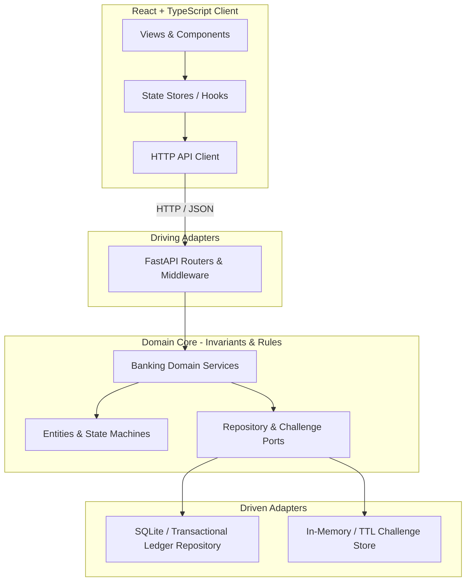
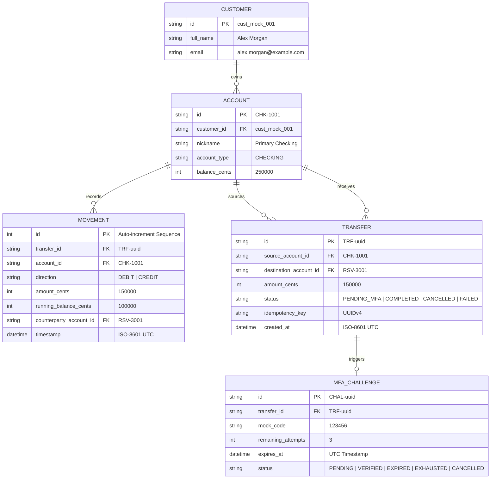
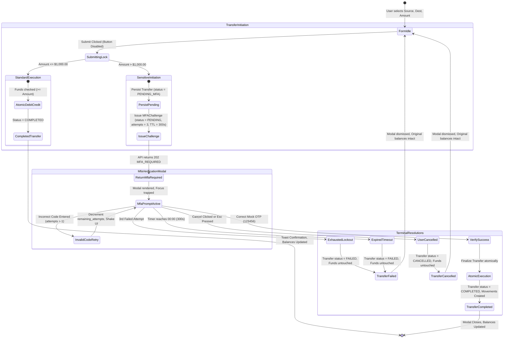

# Architecture Spine — Shift Bank (Stage 1)

## Design Paradigm

The backend architecture follows **Hexagonal Architecture (Ports and Adapters)**. Core financial entities (Account, Transfer, Movement, MFAChallenge) and domain invariants (monetary precision, balance conservation, overdraft prevention, transfer state machine) reside entirely within the inner domain core, isolated from external frameworks, HTTP transports, and database drivers.

The frontend follows a **Clean Component-Store Pattern** in React and TypeScript. State stores orchestrate asynchronous API communications, handle client-side validation rules, and drive view state transitions. Optimistic balance updates are strictly prohibited; the UI reflects account positions and movements only after authoritative API transaction confirmation.



---

## Invariants & Rules

### AD-1 — Integer Minor Units for Monetary Precision

- **Binds:** FR-2, FR-4, NFR-1, Domain Models, Persistence Layer, API Contracts
- **Prevents:** Floating-point rounding discrepancies, binary fraction drift, and financial ledger mismatch.
- **Rule:** Binary floating-point types (`float` in Python, standard unscaled `number` in TypeScript) are strictly banned for monetary calculations and storage. All monetary balances, transfer amounts, and ledger deltas must be stored, computed, and compared as **integer minor units (cents)**. On API boundaries, values must serialize as both integer `cents` and fixed two-decimal strings (e.g., `"2500.00"`). The frontend must parse monetary values as cents and format for display using `Intl.NumberFormat('en-US', { style: 'currency', currency: 'USD' })`.

### AD-2 — ACID Transactional Atomicity & Balance Conservation

- **Binds:** FR-5, FR-6, FR-13, NFR-2, Transfer Execution Service
- **Prevents:** Partial transfer execution, orphaned debits/credits, balance duplication, or overdraft states.
- **Rule:** Intra-account transfers must execute within a single isolated relational transaction boundary (`BEGIN IMMEDIATE TRANSACTION` in SQLite). The operation must execute three atomic mutations:
  1. Decrement source account balance (`UPDATE account SET balance_cents = balance_cents - :amt WHERE id = :src AND balance_cents >= :amt`).
  2. Increment destination account balance (`UPDATE account SET balance_cents = balance_cents + :amt WHERE id = :dst`).
  3. Insert two linked ledger movements (one `DEBIT`, one `CREDIT`) referencing the identical `transfer_id`.
  If source balance is insufficient, the statement affects 0 rows, prompting immediate rollback and raising `INSUFFICIENT_FUNDS`. Invariant guarantee: The sum of customer balances across all accounts after execution must equal the sum before execution (sum(B_after) == sum(B_before)).

### AD-3 — Domain Transfer State vs. API Response Discriminator Separation

- **Binds:** FR-8, FR-9, FR-10, FR-11, API Endpoints, Domain Models
- **Prevents:** Conflating persisted database entity states with transient HTTP action directives.
- **Rule:** The system enforces a strict distinction between persisted domain states and API response discriminators:
  - **Persisted Domain States (Database `transfer.status`):** `PENDING_MFA` (persisted sensitive transfer awaiting verification), `COMPLETED` (fully settled), `CANCELLED` (abandoned/cancelled by user), `FAILED` (permanently aborted due to expired or exhausted challenge).
  - **API Initiation Response Discriminator (`POST /api/transfers` payload `status`):** Returns `MFA_REQUIRED` when initiating a Sensitive Transfer ($> \$1,000.00$) to instruct the client to render the MFA modal, or `COMPLETED` when a Standard Transfer ($\le \$1,000.00$) is finalized immediately.

### AD-4 — Mock Customer Identity & Session Context Boundary

- **Binds:** FR-1, NFR-3, HTTP Middleware, Data Access Layer
- **Prevents:** Cross-customer account leakage and multi-tenant security vulnerabilities.
- **Rule:** The application operates within the boundary of a single pre-authenticated customer profile: **Alex Morgan** (`cust_mock_001`). The frontend includes the customer identity header `X-Customer-Id: cust_mock_001` with every API request. A FastAPI dependency extracts this context and scopes all account queries and transfer authorizations to this ID. Any attempt to interact with an account not owned by `cust_mock_001` is rejected with `HTTP 403 Forbidden`.

### AD-5 — Idempotency Key & Concurrency Locking

- **Binds:** FR-7, NFR-2, Transfer Router, Transfer Service
- **Prevents:** Double-debiting from rapid successive button clicks or network retries.
- **Rule:** Every transfer initiation request must include a client-generated UUIDv4 `Idempotency-Key` header. The backend validates and caches the idempotency key in an in-memory/cache table with a 60-second TTL. If a duplicate request arrives with the same key while the initial request is in-flight or completed, the server returns the cached response without re-executing balance mutations. The frontend must disable submit buttons and render loading spinners immediately upon form submission.

### AD-6 — Ephemeral MFA Challenge Lifecycle & Security Limits

- **Binds:** FR-8, FR-9, FR-10, FR-11, MFA Service, MFA Controller
- **Prevents:** Brute-force verification, stale transfer execution, and unverified high-value movements.
- **Rule:** Transfers exceeding $1,000.00 USD (100,000 cents) generate an ephemeral `MfaChallenge` record with:
  - **Time-To-Live (TTL):** Exactly 300 seconds (5 minutes) from issuance (`expires_at`). Submitting after 300 seconds returns `HTTP 410 Gone` (`MFA_CHALLENGE_EXPIRED`), marking the transfer `FAILED`.
  - **Max Verification Attempts:** Exactly 3 failed attempts allowed (`remaining_attempts: 3`). Each incorrect code submission decrements the counter and returns `HTTP 400 Bad Request` with remaining count. On the 3rd failure, the challenge transitions to `EXHAUSTED` (`HTTP 403 Forbidden`), and the transfer transitions to `FAILED`.
  - **Universal Mock Code:** In Stage 1 sandbox mode, OTP `123456` is accepted as valid.
  - **Clean Cancellation:** Requesting `POST /api/mfa/cancel` or closing the modal transitions challenge and domain transfer to `CANCELLED`, releasing funds with zero balance deductions.

### AD-7 — Immutable Dual-Entry Ledger & Sequence Tie-Breaking

- **Binds:** FR-12, FR-13, Movement Repository, Movement Router
- **Prevents:** Orphaned debit/credit rows, mutable audit records, and indeterminate transaction ordering.
- **Rule:** Movements are strictly immutable append-only ledger rows. No `UPDATE` or `DELETE` operations are permitted on movement tables. Every executed transfer must generate exactly two movement rows tied to the same `transfer_id`:
  1. `DEBIT` movement on Source Account (`amount_cents`, signed negative delta, resulting running balance).
  2. `CREDIT` movement on Destination Account (`amount_cents`, signed positive delta, resulting running balance).
  Movements are queried by `account_id` and ordered strictly by `timestamp` descending. If two movements share the identical millisecond timestamp, the database auto-incrementing `id` descending serves as the deterministic tie-breaker.

### AD-8 — Pre-Seeded Dataset Allocation & Out-of-the-Box FR-14 Demonstrability

- **Binds:** FR-1, FR-12, FR-14, Database Seeder
- **Prevents:** Inability to demonstrate empty-state behavior and test execution failures due to mismatched initial balances.
- **Rule:** The database seeder initializes the application with a fixed, deterministic dataset:
  - **Primary Checking (`CHK-1001`):** Balance $2,500.00 (`250000` cents), pre-seeded with exactly **7 movements**.
  - **High-Yield Savings (`SAV-2001`):** Balance $12,450.75 (`1245075` cents), pre-seeded with exactly **3 movements**.
  - **Emergency Reserve (`RSV-3001`):** Balance $5,000.00 (`500000` cents), pre-seeded with exactly **0 movements**.
  Assigning 0 movements to Emergency Reserve guarantees that **FR-14 (Zero-Movement State Presentation)** is demonstrable immediately upon application launch without manual database modifications.

### AD-9 — Synchronous Client View Synchronization & Prohibition of Optimistic Updates

- **Binds:** NFR-4, Frontend Account Store, Transfer Hook
- **Prevents:** UI state desynchronization, ghost balances, and flashing rollback states.
- **Rule:** The frontend must never optimistically alter account balances or prepend hypothetical movements before receiving a successful HTTP 200 response from the backend. Upon receiving transfer completion confirmation, the frontend store refetches or atomically reconciles the updated account balances and movement lists from the server response payload.

### AD-10 — Standardized Error Envelope & HTTP Status Mapping

- **Binds:** All API Endpoints, Frontend Error Handlers
- **Prevents:** Inconsistent client error parsing and unhandled exception crashes.
- **Rule:** All backend error responses must conform to a standardized JSON error envelope:
  ```json
  {
    "error": {
      "code": "INSUFFICIENT_FUNDS",
      "message": "Source account balance is insufficient for transfer amount.",
      "details": { "available_cents": 250000, "requested_cents": 350000 }
    }
  }
  ```
  Status code mappings are locked:
  - `400 Bad Request`: Same-account transfer attempt (`SAME_ACCOUNT_TRANSFER_NOT_ALLOWED`), invalid OTP retry (`MFA_INVALID_CODE`).
  - `403 Forbidden`: Cross-customer unauthorized account access (`UNAUTHORIZED_ACCOUNT`), MFA attempts exhausted (`MFA_ATTEMPTS_EXHAUSTED`).
  - `410 Gone`: MFA challenge timed out (`MFA_CHALLENGE_EXPIRED`).
  - `422 Unprocessable Entity`: Negative or zero amount (`INVALID_TRANSFER_AMOUNT`), insufficient funds (`INSUFFICIENT_FUNDS`).

---

## Consistency Conventions

| Concern | Convention |
|---|---|
| **Entity Naming** | PascalCase in Python classes / TypeScript interfaces (`Account`, `Transfer`, `Movement`, `MfaChallenge`). |
| **Database Tables** | Lower snake_case plural (`accounts`, `transfers`, `movements`, `mfa_challenges`). |
| **API Endpoints** | Lower kebab-case plural REST endpoints (`/api/accounts`, `/api/transfers`, `/api/mfa/verify`, `/api/mfa/cancel`). |
| **Identifiers** | Prefixed string UUIDs or formatted codes (`cust_mock_001`, `CHK-1001`, `SAV-2001`, `RSV-3001`, `TRF-uuid`, `CHAL-uuid`). |
| **Monetary Naming** | Explicit unit suffix `_cents` on integer fields (`balance_cents`, `amount_cents`, `running_balance_cents`). Formatted string fields named `balance_formatted`, `amount_formatted`. |
| **Timestamps** | ISO 8601 UTC strings with 'Z' suffix (`2026-10-20T14:30:00Z`). Database stores integer epoch milliseconds or UTC ISO text. |
| **State Enumerations** | UPPER_SNAKE_CASE string literals (`PENDING_MFA`, `COMPLETED`, `CANCELLED`, `FAILED`, `MFA_REQUIRED`, `CHECKING`, `SAVINGS`, `RESERVE`, `DEBIT`, `CREDIT`). |

---

## Stack

| Component / Layer | Technology | Pinned Version | Purpose |
|---|---|---|---|
| **Backend Language** | Python | 3.11.9+ | Core runtime platform |
| **Web Framework** | FastAPI | 0.115.0 | High-performance asynchronous API framework & OpenAPI |
| **Data Validation** | Pydantic | 2.9.2 | Type validation and JSON schema serialization |
| **ASGI Server** | Uvicorn | 0.31.0 | Asynchronous HTTP server implementation |
| **Database** | SQLite | 3.45.0+ | ACID-compliant relational persistence engine (WAL mode) |
| **Frontend Language** | TypeScript | 5.6.2 | Strongly typed client language |
| **Frontend Framework** | React | 18.3.1 | Declarative component UI library |
| **Build Tool** | Vite | 5.4.8 | High-speed frontend bundling and dev server |
| **HTTP Client** | Axios / Native Fetch | 1.7.7 | Type-safe HTTP communication with backend |
| **Test Runner (Py)** | Pytest | 8.3.3 | Automated backend unit and integration test suite |
| **Test Runner (JS)** | Vitest | 2.1.2 | Automated frontend unit and component test suite |

---

## Structural Seed

### 1. Minimal Source Tree Layout

```text
shift-bank/
├── backend/
│   ├── app/
│   │   ├── main.py                    # FastAPI application factory and router mounts
│   │   ├── config.py                  # Environment settings and constants
│   │   ├── core/
│   │   │   ├── database.py            # SQLite connection, transaction context manager, WAL mode
│   │   │   └── seed.py                # Pre-seeded customer, accounts, and initial movements
│   │   ├── domain/
│   │   │   ├── models.py              # Account, Transfer, Movement, MFAChallenge domain entities
│   │   │   └── exceptions.py          # Domain-level banking exceptions
│   │   ├── schemas/
│   │   │   ├── account.py             # Pydantic request/response schemas for accounts
│   │   │   ├── transfer.py            # Transfer initiation, status, and payload schemas
│   │   │   └── mfa.py                 # MFA verification, challenge, and retry schemas
│   │   ├── services/
│   │   │   ├── account_service.py     # Account query and balance calculation services
│   │   │   ├── transfer_service.py    # Atomic transfer execution, threshold routing, balance checks
│   │   │   └── mfa_service.py         # MFA challenge issuance, verification, TTL, and attempt tracking
│   │   └── api/
│   │       ├── dependencies.py        # Customer context extraction (X-Customer-Id)
│   │       ├── accounts.py            # GET /api/accounts, GET /api/accounts/{id}/movements
│   │       ├── transfers.py           # POST /api/transfers (initiate standard/sensitive transfer)
│   │       └── mfa.py                 # POST /api/mfa/verify, POST /api/mfa/cancel
│   ├── tests/
│   │   ├── test_accounts.py           # Account balance and portfolio tests
│   │   ├── test_transfers.py          # Atomic transfer, overdraft, and balance conservation tests
│   │   └── test_mfa.py                # MFA threshold, verification, expiry, and lockout tests
│   └── requirements.txt
├── frontend/
│   ├── src/
│   │   ├── App.tsx                    # Top-level shell and layout assembly
│   │   ├── main.tsx                   # React root entry point
│   │   ├── types/
│   │   │   ├── account.ts             # Account and Movement TypeScript models
│   │   │   └── transfer.ts            # Transfer request, response, and MFA modal state types
│   │   ├── api/
│   │   │   ├── client.ts              # Fetch/Axios instance with X-Customer-Id header injection
│   │   │   ├── accounts.ts            # API functions for accounts and movements
│   │   │   └── transfers.ts           # API functions for transfer initiation, verify, and cancel
│   │   ├── hooks/
│   │   │   ├── useAccounts.ts         # Hook for account portfolio and selected account state
│   │   │   └── useTransfer.ts         # Hook for transfer submission and MFA modal orchestration
│   │   └── components/
│   │       ├── Navbar.tsx             # Global header with Alex Morgan identity badge
│   │       ├── AccountGrid.tsx        # 3-card account portfolio display
│   │       ├── AccountCard.tsx        # Individual account card with active border indicator
│   │       ├── TransferForm.tsx       # Transfer initiation panel with source/destination locks
│   │       ├── MovementLedger.tsx     # Chronological movements table with tabular numerals
│   │       ├── EmptyState.tsx         # FR-14 zero-movement vault display for Emergency Reserve
│   │       └── MfaModal.tsx           # Focus-trapped MFA dialog with 300s timer and 6 OTP boxes
│   ├── package.json
│   ├── tsconfig.json
│   └── vite.config.ts
```

### 2. Domain Entity Relationship Diagram



### 3. Sensitive Transfer State Machine Lifecycle



### 4. Deployment & Runtime Environment

- **Execution Topology**: Self-contained client-server web architecture running locally in development sandbox.
- **Backend Runtime**:
  - Python ASGI service executed via `uvicorn app.main:app --host 127.0.0.1 --port 8000 --reload`.
  - Database: Local SQLite file (`shift_bank.db`) in WAL (Write-Ahead Logging) mode to support concurrent read operations alongside transactional write locks.
- **Frontend Runtime**:
  - Vite development server executed via `npm run dev` at `http://localhost:5173`.
  - Vite reverse-proxy configured in `vite.config.ts` mapping `/api` to `http://127.0.0.1:8000` to eliminate CORS friction during development.
- **Environment Configuration**:
  - Backend: `.env` file declaring `ENV=development`, `DATABASE_PATH=shift_bank.db`, `DEFAULT_MOCK_CUSTOMER_ID=cust_mock_001`, `SENSITIVE_THRESHOLD_CENTS=100000`, `MFA_TTL_SECONDS=300`.
  - Frontend: `VITE_API_BASE_URL=/api`.

---

## Capability → Architecture Map

| Capability / Requirement | Lives in Module / Component | Governed by Invariant / Convention |
|---|---|---|
| **FR-1: Account Portfolio Listing** | `backend/app/api/accounts.py`, `frontend/src/components/AccountGrid.tsx` | AD-4 (Mock Customer Boundary), AD-8 (Pre-Seeded Dataset) |
| **FR-2: Balance Currency Display** | `backend/app/schemas/account.py`, `frontend/src/components/AccountCard.tsx` | AD-1 (Integer Minor Units), DESIGN.md (`mono-balance`) |
| **FR-3: Transfer Formulation & Validation** | `frontend/src/components/TransferForm.tsx`, `backend/app/schemas/transfer.py` | AD-10 (Same-account 400 validation), EXPERIENCE.md |
| **FR-4: Transfer Amount Constraints** | `backend/app/schemas/transfer.py`, `frontend/src/components/TransferForm.tsx` | AD-1 (Cents scale, positive amount check), AD-10 |
| **FR-5: Fund Availability Check** | `backend/app/services/transfer_service.py` | AD-2 (Atomic balance check before debit), AD-10 |
| **FR-6: Atomic Execution & Conservation** | `backend/app/services/transfer_service.py`, `database.py` | AD-2 (ACID isolated transaction, balance conservation) |
| **FR-7: Duplicate Submission Protection** | `backend/app/core/database.py`, `frontend/src/components/TransferForm.tsx` | AD-5 (Idempotency key 60s cache, client submit lock) |
| **FR-8: Sensitive Transfer Threshold** | `backend/app/services/transfer_service.py` | AD-3 (Domain PENDING_MFA vs API MFA_REQUIRED), AD-6 |
| **FR-9: MFA Verification Lifecycle** | `backend/app/api/mfa.py`, `frontend/src/components/MfaModal.tsx` | AD-3, AD-6 (OTP 123456, 300s TTL, 3 attempts) |
| **FR-10: MFA Expiration & Limits** | `backend/app/services/mfa_service.py`, `frontend/src/components/MfaModal.tsx` | AD-6 (300s expiration, 3 attempts lockout), AD-10 |
| **FR-11: MFA Challenge Cancellation** | `backend/app/api/mfa.py`, `frontend/src/components/MfaModal.tsx` | AD-6 (Cancel endpoint, side-effect-free return to form) |
| **FR-12: Chronological Movement Ledger** | `backend/app/api/accounts.py`, `frontend/src/components/MovementLedger.tsx` | AD-7 (Immutable dual-entry, descending timestamp sort) |
| **FR-13: Dual-Entry Movement Creation** | `backend/app/services/transfer_service.py` | AD-2, AD-7 (Paired DEBIT/CREDIT records per transfer) |
| **FR-14: Zero-Movement State** | `frontend/src/components/EmptyState.tsx`, `backend/app/core/seed.py` | AD-8 (Emergency Reserve seeded with 0 movements) |
| **NFR-1: Monetary Arithmetic Precision** | `backend/app/domain/models.py`, `frontend/src/types/account.ts` | AD-1 (Integer cents throughout, zero float math) |
| **NFR-2: Transaction Atomicity** | `backend/app/core/database.py` | AD-2 (SQLite BEGIN IMMEDIATE, atomic rollback) |
| **NFR-3: Security & Session Isolation** | `backend/app/api/dependencies.py` | AD-4 (X-Customer-Id context injection) |
| **NFR-4: UI Responsiveness & Sync** | `frontend/src/hooks/useTransfer.ts`, `useAccounts.ts` | AD-9 (Prohibition of optimistic balance updates) |

---

## Deferred

| Deferred Area | Revisit Trigger | Reason Deferred for Stage 1 |
|---|---|---|
| **Cumulative Daily Transfer Threshold** | Stage 2 Multi-transfer Risk Policy | Calculating rolling 24-hour velocity windows adds unnecessary state machine complexity to Stage 1. Single per-transaction threshold (> $1,000.00) deterministically satisfies all core safety criteria. |
| **Transaction Pagination & Date Filtering** | Stage 2 Account Scalability | Stage 1 pre-seeds a small, controlled dataset (~10 movements total); simple array delivery meets all performance budgets (< 50ms query time). |
| **Distributed Cache for Idempotency & MFA** | Stage 2 Cloud Deployment | Single-node in-memory / SQLite backing provides strict consistency without requiring external Redis dependencies in local development. |
| **PostgreSQL Migration** | Stage 2 Production Multi-User Launch | SQLite with WAL mode perfectly simulates relational ACID transactions and row-locking invariants for a single-customer sandbox while requiring zero external daemon management. |
| **Live SMS / Authenticator WebAuthn** | Stage 2 Identity Infrastructure | Eliminates third-party gateway costs, SMS delivery latency, and external flaky network dependencies during automated integration testing. |
