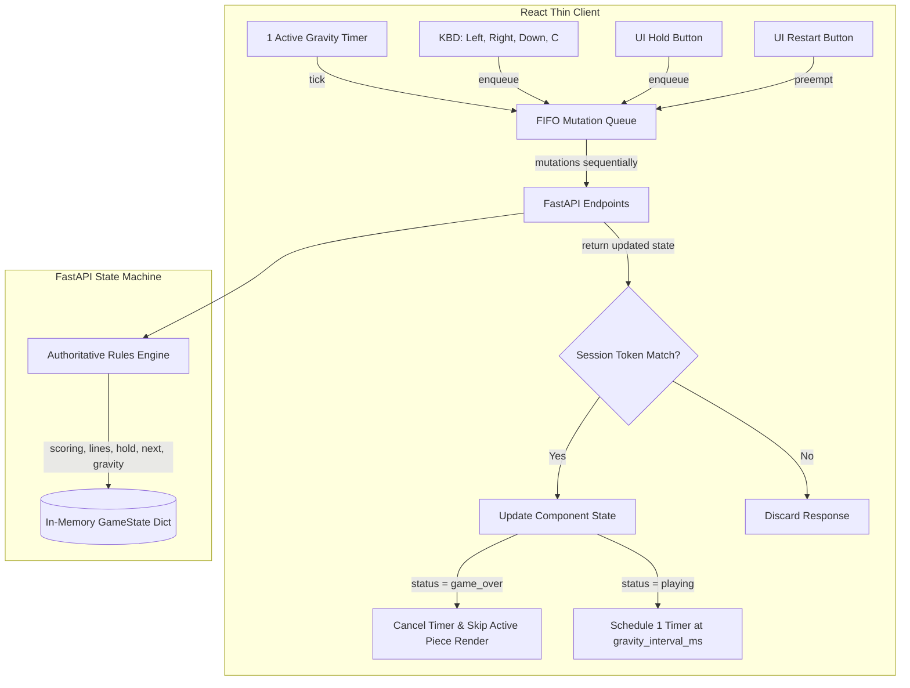

# Architecture Spine — Stage 2 Tetris Study (Option A)

## Inherited Invariants
This feature-altitude architecture spine directly inherits the core decoupled client-server paradigm and constraints from Stage 1:
- **AD-1 (Authoritative Backend State Machine):** The Python FastAPI backend remains the sole source of truth and validator for all game rules, collisions, and state.
- **AD-3 (Standard Board Properties & Coordinates):** The board is strictly 10 columns by 20 rows.
- **AD-6 (Ephemeral In-Memory Sessions):** Game sessions are stored in-memory using a standard Python dictionary mapping UUID keys to game state instances on the backend.

## Design Paradigm
The system maintains the strictly decoupled client-server architecture of Stage 1. The React frontend continues to act as a stateless renderer of the game board, active piece, and now the HUD sidebars (score, cleared lines, current level, next preview, and hold slot). It coordinates gravity timer schedules directly using the backend's authoritative `gravity_interval_ms` property.

## Invariants & Rules

### AD-7 — Unified Authoritative Game State Payload
- **Binds:** FR-31, FR-32, FR-33, FR-45, FR-49
- **Prevents:** Client-side desynchronization, state manipulation, and data mismatch.
- **Rule:** Both the frontend and backend must strictly conform to the 11-field payload schema. All game state attributes—`score`, `total_lines`, `level`, `gravity_interval_ms`, `next_piece`, `hold_piece` (nullable), and `can_hold`—are calculated, stored, and updated exclusively on the backend. Peeking at state (via `GET`) is immutable and performs exactly zero (0) RNG draws.

### AD-8 — Canonical RNG Draw Accounting
- **Binds:** FR-40, FR-41, FR-46, FR-47, FR-51, FR-52, FR-53, FR-54
- **Prevents:** Piece queue drifting, redundant draws, and prediction mismatches.
- **Rule:** Piece spawning and Hold mechanics must strictly account for RNG draws:
  1. Game creation/Restart: Draws exactly 2 pieces (one for `active_piece`, one for `next_piece`).
  2. Normal piece lock (post-clear): Consumes `next_piece` preview to spawn the next active piece, and draws exactly 1 new random piece for the next preview.
  3. Empty Hold swap: Stores `active_piece` in hold, consumes `next_piece` to spawn, and draws exactly 1 new random piece for the next preview.
  4. Occupied Hold swap: Swaps `active_piece` and `hold_piece`, spawning the retrieved piece at its standard template origin. This does NOT consume the next preview, resulting in exactly zero (0) RNG draws.
  5. Terminal actions, rejected actions, and state peeks (GET): Perform exactly zero (0) RNG draws.

### AD-9 — Client-side FIFO Mutation Queue and Single Active Timer
- **Binds:** FR-34, NFR-3, NFR-4
- **Prevents:** Timer jitter, duplicate/overlapping gravity ticks, and network-induced race conditions.
- **Rule:** The frontend client manages automatic tick intervals using exactly one active automatic timer.
  1. On enqueuing any mutation (move, hold, gravity tick, restart), the active timer is immediately canceled.
  2. All mutations are processed sequentially in a strict FIFO queue; overlapping or concurrent fetch/JSON requests are prohibited.
  3. After the very last queued response completes, schedule exactly one full gravity interval matching the newly updated `gravity_interval_ms` (e.g., waiting 450ms after completing execution when crossing to level 2; none at 449ms).
  4. If the final state returned has status `"game_over"`, the timer is completely cleared and no timer remains.
  5. Preemption on Restart: Clicking Restart must immediately preempt and discard the old mutation queue, clearing any pending timer, without waiting for any prior pending fetch/JSON requests to finish.

### AD-10 — Component Lifecycle & Ownership Checks
- **Binds:** FR-34, NFR-3, NFR-4
- **Prevents:** State corruption from obsolete callbacks, components unmounting, or React StrictMode double effect runs.
- **Rule:** The frontend client must track monotonically increasing unique generation tokens to verify session ownership.
  1. Check ownership after every `fetch`, after every `.json()`, in all `catch`/`finally` blocks, and inside all timer callbacks.
  2. If the callback's generation token does not match the active session, the callback is discarded and must not mutate component state, loading, error, guard, or timer variables. Falsy rejected values are ignored and do not mutate state.

### AD-11 — HUD sidebar, Preview, Hold, and UI Layout
- **Binds:** FR-34, FR-38, FR-39, FR-42, FR-48
- **Prevents:** Interactive control collision, visual lag, and rendering invalid overlapping active pieces on game over.
- **Rule:** The frontend UI must render Score, Lines, Level, Hold Slot (with Hold button), and Next Preview panels alongside the 10x20 board.
  1. Provide the `C` key and Hold button to trigger Hold swaps (usable and queueable while other movements are pending).
  2. To prevent rendering illegal overlapping active cells during a game-over spawn transition, the client checks if `status === "game_over"`. If so, the `active_piece` field is null and active piece rendering is bypassed.
  3. Existing manual movement arrow keys and Start/Restart controls are preserved.

### AD-12 — Backward Compatibility and Endpoint Integrity
- **Binds:** FR-38, FR-44
- **Prevents:** API breaks, route-clashing, and state pollution on invalid requests.
- **Rule:** All endpoints `POST /api/games`, `GET /api/games/:id`, `POST /api/games/:id/tick`, `POST /api/games/:id/move`, and the new `POST /api/games/:id/hold` return the unified GameState schema. Game creation returns HTTP 201 Created. Move validations continue returning HTTP 422 for illegal moves. Missing IDs return HTTP 404. Valid or cooldown/gameover no-op Hold requests return HTTP 200 with the unchanged state and 0 RNG draws.

### AD-13 — Non-Rotational 3/4 Clear Production-Path Test Strategy
- **Binds:** FR-50, FR-52, SM-3, SM-4
- **Prevents:** Implementation of unnecessary rotation mechanics while achieving >= 80% test coverage with 0 Sonar gate violations.
- **Rule:** To test 3-row and 4-row clears without implementing piece rotation, automated tests must use canonical `"O"` pieces above precompleted bottom rows:
  - **3-Row Clear Test (N=3):** Precomplete rows 17, 18, and 19 (full). Row 16 is empty. Lock the O piece at origin `(15,4)` with cells `(15,4), (15,5), (16,4), (16,5)` via downward move/tick. Verify exactly 3 rows are cleared.
  - **4-Row Clear Test (N=4):** Precomplete rows 16, 17, 18, and 19 (full). Row 15 is empty. Lock the O piece at origin `(14,4)` with cells `(14,4), (14,5), (15,4), (15,5)` via downward move/tick. Verify exactly 4 rows are cleared.
  - Keep historical one-cell tests completely unchanged as an isolated regression, but do not use them to represent new canonical gameplays.

## Consistency Conventions

| Concern | Convention |
| --- | --- |
| Naming | Endpoints grouped under `/api/games`. Backend Python attributes in snake_case, matched with snake_case keys in API JSON payloads. |
| Data & formats | Game sessions identified by UUID strings. GameState contains: `id` (UUID), `status` (`playing` | `game_over`), `board` (2D grid), `active_piece` (shape, origin, cells) | `null`, `score`, `total_lines`, `level`, `gravity_interval_ms`, `next_piece`, `hold_piece`, `can_hold`. |
| State & cross-cutting | Ephemeral dict session storage. Exception handling returns standard FastAPI 422/404 HTTP errors. |

## Stack

| Name | Version |
| --- | --- |
| Python | >= 3.10 |
| FastAPI | ^0.100.0 |
| React | ^18.2.0 |
| TypeScript | ^5.0.0 |
| tsc / npm | ci / build compatible |
| pytest | with coverage |
