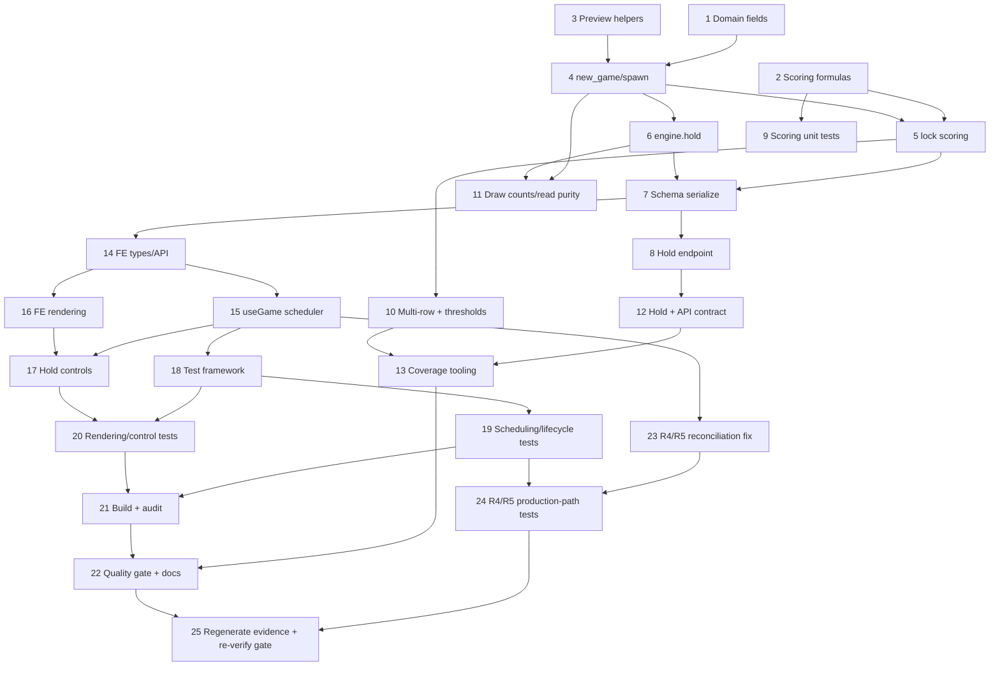

# Implementation Plan

> Implementation complete. All tasks below are verified: backend and frontend tests pass, coverage artifacts were produced (docs/coverage.xml and frontend/coverage/lcov.info), the production build and dependency audit ran, and the controlled Sonar quality gate passed (new coverage 91.8%, new duplication 0.0%, 0 new violations). One spec defect surfaced during implementation (the legacy exact top-level key-set assertion is incompatible with Requirement 6.1) and was resolved by revising the spec first, then widening only that single assertion; no behavioral regression assertion was weakened. A follow-up correction (tasks 23+) addresses two newly reproduced queued-manual gravity-timeout defects (R4/R5) in `useGame`, revised in the native spec first before any code change.

## Overview

This plan implements Stage 2, Option A as a brownfield extension of the Stage 1 backend and frontend. Backend tasks (1-13) extend the pure engine, scoring, preview queue, Hold, serialization, the new Hold endpoint, and backend tests/coverage tooling. Frontend tasks (14-21) add types/API, the generation-scoped scheduler and request ordering, rendering, Hold controls, the test framework, tests, and build/audit evidence. Task 22 verifies the controlled quality gate and documents commands. Backend runtime pins are preserved; coverage tooling is added only as dev dependencies.

## Tasks
- [x] 1. Extend backend domain model with Stage 2 fields
  - Add `score`, `total_lines`, `level`, `gravity_interval_ms`, `next_type`, `hold_type`, and `can_hold` to the `Game` dataclass in `app/domain/models.py`
  - Keep `ActivePiece`, `Board`, `PieceType`, `Status`, `empty_board`, `ROWS`, `COLS` unchanged
  - Do not change canonical shapes or the generator; keep queued/spawn/Hold rules and 7-bag behavior exactly as frozen in the seed
  - _Requirements: 1, 6, 11_

- [x] 2. Add pure scoring/level/gravity formulas
  - Create `app/rules/scoring.py` with `line_award(cleared, pre_lock_level)`, `level_for(total_lines)`, and `gravity_ms_for(level)`
  - Encode the exact tables: 0/1/2/3/4 -> 0/100/300/500/800; `level = 1 + total_lines // 10`; `gravity = max(100, 500 - 50*(level-1))`
  - _Requirements: 2, 3, 4_

- [x] 3. Add preview-queue helpers to the engine
  - Add `_draw_preview` (exactly one `pieces.next_type` draw) and `_consume_preview` (return current preview, refill with one draw) to `app/rules/engine.py`
  - Do not modify `app/rules/pieces.py`
  - _Requirements: 6, 7_

- [x] 4. Update `new_game` and `spawn` to use the preview queue
  - Initialize all Stage 2 counters and hold state in `new_game`; draw the first preview before the first spawn
  - Make `spawn` consume the preview (one draw to refill) and place at the canonical origin `(SPAWN_ROW=0, SPAWN_COLUMN=3)`; retain spawn-collision -> `game_over`
  - Ensure a normal spawn performs exactly one generator draw; `next_piece` remains a valid queued type after game over (no extra draw)
  - _Requirements: 1, 7, 11_

- [x] 5. Add scoring, leveling, gravity, and hold re-enable to `lock`
  - In `lock`: settle -> `clear_lines` -> compute award with the pre-lock level -> update `total_lines`, `level`, `gravity_interval_ms` -> set `can_hold = True` -> `spawn`
  - Preserve the settle -> clear -> spawn ordering; ensure soft drop grants no points (score only changes inside `lock`)
  - Implement the primary TOTAL LINES 9 -> 10 threshold so a pre-lock level-1 single clear awards 100, then level 2 and gravity 450; the level-9-to-10 crossing occurs at total_lines 89 -> 90 (pre-lock level 9 award 900, gravity -> 100)
  - _Requirements: 2, 3, 4, 8, 9, 12_

- [x] 6. Implement `engine.hold`
  - No-op when not playing, no active piece, or `can_hold` is false (zero draws)
  - Empty slot: move active type to hold, consume preview (one draw), place incoming at the canonical spawn origin, set `can_hold=false`
  - Occupied slot: swap active/hold (zero draws), place incoming at the canonical spawn origin, set `can_hold=false`
  - Incoming piece blocked at the canonical spawn origin -> `game_over`, clear active (seed-frozen behavior)
  - _Requirements: 7, 8, 10_

- [x] 7. Extend API schema serialization
  - Add `score`, `total_lines`, `level`, `gravity_interval_ms`, `next_piece`, `hold_piece`, `can_hold` to `GameStateOut` in `app/api/schemas.py`
  - Keep board as integer codes, the active piece under `active_piece`, and the `(0,3)` spawn origin
  - Map `next_type -> next_piece`, `hold_type -> hold_piece`
  - _Requirements: 6, 12_

- [x] 8. Add the Hold endpoint controller
  - Add `POST /api/games/{id}/hold` in `app/api/games.py` calling `engine.hold` and returning the serialized state; reuse `_get_or_404`
  - Keep `POST /api/games` at HTTP 200 and the other routes unchanged
  - _Requirements: 8, 12_

- [x] 9. Backend tests: scoring/level/gravity units
  - Test `line_award` for 0-4 rows across levels; `level_for` boundaries (9->1, 10->2); `gravity_ms_for` at 1/2/9/10+ with the 100 ms floor
  - _Requirements: 2, 3, 4, 18_

- [x] 10. Backend tests: isolated-domain multi-row clears and the line thresholds (production path)
  - Explicitly labeled fixtures with prefilled complete rows driving the real `engine.lock`/`clear_lines` path for 1/2/3/4-row awards and resulting counters/level/gravity
  - Add a runnable production-path test for the primary TOTAL LINES 9 -> 10 threshold: pre-lock level 1, total_lines 9, one-row clear -> award 100, total_lines 10, level 2, gravity 450
  - Add a runnable production-path test for the 89 -> 90 crossing: pre-lock level 9, total_lines 89, one-row clear -> award 900, total_lines 90, level 10, gravity 100
  - Do not mutate canonical shapes and do not invent rotated or custom gameplay pieces
  - _Requirements: 2, 3, 4, 5, 18_

- [x] 11. Backend tests: preview draw counts and state-read purity
  - Assert exactly one draw on normal spawn and first Hold; zero on occupied swap, rejected Hold, reads, and post-game-over actions
  - Assert repeated `GET` leaves all fields and generator state unchanged (no extra draw); assert `next_piece` stays a valid queued type on game over
  - _Requirements: 6, 7, 10, 18_

- [x] 12. Backend tests: Hold mechanics and API contract
  - Empty-slot hold, occupied swap, rejection when `can_hold` false, re-enable after lock, incoming spawn-collision at the canonical origin -> game over, 404 unknown id, no-op after game over, response shape
  - New test asserting the expanded top-level key set, HTTP 200 on create, integer-coded board, `active_piece` key, and `(0,3)` spawn origin
  - Widen only the single exact top-level key-set equality in the legacy `test_state_payload_shape` to include the Stage 2 fields required by Requirement 6.1 (that equality cannot coexist with new required keys); keep its active-piece sub-shape assertion and every other behavioral assertion unchanged
  - Confirm all 39 legacy backend test functions still pass with that single documented top-level key-set widening as the only legacy-assertion change
  - _Requirements: 8, 12, 18_

- [x] 13. Backend coverage tooling and artifact (compatible dev dependency)
  - Add `backend/requirements-dev.txt` that references `-r requirements.txt` and pins a compatible `pytest-cov` (e.g. `pytest-cov==6.0.0` for `pytest==8.3.4`); do NOT change the runtime pins in `backend/requirements.txt`
  - Document and run: `pip install -r requirements-dev.txt` BEFORE any `--cov` use; then `pytest --cov=app --cov-report=xml:../docs/coverage.xml`; record exact command and exit status
  - Do not assume the `--cov` flag exists in the baseline runtime; if the dev install is skipped, use the documented stdlib `coverage` fallback instead of claiming the flag
  - _Requirements: 18_

- [x] 14. Frontend types and API client
  - Add the 7 new fields to `GameState` in `src/types.ts`; add `holdGame(id)` to `src/api.ts`
  - _Requirements: 6, 13, 14_

- [x] 15. Rewrite `useGame` for generation-scoped FIFO ordering and coalesced dynamic ticks
  - Add a generation token bumped on create/restart/dispose; validate generation after `fetch` and after `response.json()`, including create/restart and error/finally paths
  - Serialize manual mutating requests FIFO per generation; isolate queues across generations; allow a new game's Hold while an old Hold is pending (old-vs-new Hold)
  - Schedule automatic ticks per generation with `setTimeout(gravity_interval_ms)`, coalesced to at most one queued/in-flight tick; reschedule on interval change (including 500 -> 450 at the first level-up); cancel the exact pending timeout on manual input, restart, interval change, game over, and unmount
  - Ensure stale completions never clear the current guard/timer; keep StrictMode setup/cleanup/re-setup correct
  - Expose `move`, `hold`, `restart`
  - _Requirements: 15, 16_

- [x] 16. Frontend rendering of Stage 2 state
  - Add a `Preview` mini-grid component; render `score`/`total_lines`/`level`, `next_piece`, and `hold_piece` (empty state when null) in a sidebar/panel
  - No local rule logic; values come only from backend state
  - _Requirements: 13_

- [x] 17. Frontend Hold controls and preserved controls
  - Add a Hold button (disabled when `!can_hold` or not playing) and a `C`/`c` key handler that dispatch a hold request
  - Keep Left/Right/Soft Drop/Restart controls, English labels (including the Hold control and C-key affordance), and the game-over message
  - _Requirements: 13, 14, 17_

- [x] 18. Add a compatible frontend test framework (implementation phase only)
  - Add Vitest + Testing Library with `@vitest/coverage-v8` emitting LCOV at `frontend/coverage/lcov.info`; wire an `npm run test` script; pins compatible with Vite 5 (Vitest 2.x)
  - Specify this in design before installing; do not add during the specification-only phase; do not exclude production files from coverage
  - _Requirements: 18_

- [x] 19. Frontend tests: scheduling, ordering, and lifecycle
  - Dynamic interval from `gravity_interval_ms`, reschedule on change (including 500 -> 450), stop on game over
  - Delayed `fetch` and delayed `response.json()` across restart; FIFO manual actions; stale error/finally discarded; old-vs-new Hold; repeated restart; queue isolation; tick coalescing (no burst); exact timeout cancellation; StrictMode setup/cleanup/re-setup
  - Assert observable requests/state/timer timing, not implementation internals
  - _Requirements: 15, 16, 18_

- [x] 20. Frontend tests: rendering and controls
  - Score/lines/level shown from state; next preview; hold display and disabled Hold button per `can_hold`; `C`/`c` key and Hold button click dispatch a hold; existing controls still work; all visible text English
  - Ensure production `frontend/src` modules are exercised so LCOV includes all production files
  - _Requirements: 13, 14, 17, 18_

- [x] 21. Reproducible build and audit evidence
  - Run the TypeScript production build (`npm run build`) and record exact log/exit status
  - Run `npm audit --json`; plan a compatible, non-breaking remediation for the baseline 3 vulnerabilities (1 moderate, 2 high) and record the final audit honestly, with no suppression
  - _Requirements: 17, 18_

- [x] 22. Quality gate verification and documentation
  - Verify new coverage >= 80%, new duplication <= 3%, zero new violations without weakening thresholds, suppressing findings without evidence, excluding uncovered production files, weakening tests, or altering legacy regression assertions
  - Update `backend/README.md` and `frontend/README.md` with Stage 2 run/test/build/coverage/audit commands (including the `requirements-dev.txt` install step before `--cov`); document the resolved ambiguities and quality remediations before code changes
  - _Requirements: 12, 18_

- [x] 23. Fix `useGame` queued-predecessor gravity-timeout reconciliation (R4/R5)
  - In `frontend/src/useGame.ts`, inside the per-generation FIFO `enqueue` task body, after the post-`response.json()` generation re-check and after `applyIfCurrent`, cancel the exact pending gravity timeout via `cancelTick()` (which clears only `timeoutRef`, never the `tickBusyRef` coalescing guard) BEFORE deciding whether to reschedule; then call `scheduleTick(gen)` only when the applied result's status is `playing`. On a terminal (`game_over`) result, do not reschedule, so the cancel alone leaves zero pending timeouts.
  - Preserve the dispatch-time `cancelTick()` already in `move`/`hold` (R2); this ADDS the post-result reconciliation so the timeout is reconciled at dispatch AND after each current-generation manual result, each under a generation check.
  - Do not clear a coalescing guard owned by an in-flight/queued automatic tick (R3); keep stale previous-generation completions isolated (R1); preserve FIFO ordering and one-owned-tick coalescing; do not weaken any existing timer expectation.
  - _Requirements: 16.25, 16.26, 16.27, 16.28, 16.29, 16.30, 16.31_

- [x] 24. Add native frontend production-path tests for both already-queued manual cases (R4/R5)
  - Add meaningful tests under `frontend/src` driving the real `useGame` hook and `api` transport boundary with independently deferred `fetch` headers and `response.json()` bodies and fake timers, without mocking the hook. Queue two manual mutating operations before either completes; complete the first at t0 (gravity_interval_ms 500) and the second at t100.
  - R4 level-up: second completion returns level 2 / gravity_interval_ms 450; assert advancing 449ms after t100 yields zero `/tick` requests and advancing one more ms (full 450ms) yields exactly one `/tick`.
  - R5 game-over: second completion returns status `game_over`; assert advancing 1000ms yields zero `/tick` requests.
  - Preserve all existing frontend/backend test instances and their assertions (parametrization may change counts only with documented equivalent coverage); keep every executable frontend module including `main.tsx` in LCOV with no production exclusions; leave researcher harnesses, fixtures, reports, their config, and shared helpers unchanged.
  - _Requirements: 16.25, 16.26, 16.27, 16.28, 16.29, 18.17_

- [x] 25. Regenerate evidence and re-verify the quality gate for the corrected code
  - Re-run backend tests + coverage to `docs/coverage.xml`; re-run the frontend production build; re-run frontend tests with full-src LCOV to `frontend/coverage/lcov.info` (including `main.tsx`, no production exclusions); run full-tree `npm audit --json` and the production audit; record exact commands, exit statuses, versions, and denominators.
  - Preserve the historical `stage2-frontend-result.json` under a snapshot and either update it accurately or write an explicitly named `07` result; do not mix old summaries with fresh source/coverage.
  - Submit/verify/fetch a NEW Sonar analysis for the current source via the authorized sibling helpers in FINAL mode (without editing them or printing credentials), recording the exact CE task and analysis id; targets unchanged (new coverage >= 80%, new duplication <= 3%, 0 new violations). Preserve failing scans/reports separately; report inherited active findings separately. Do not suppress rules, weaken gates, or exclude production.
  - _Requirements: 18_

## Task Dependency Graph



```json
{
  "waves": [
    { "wave": 1, "tasks": ["1", "2", "3"] },
    { "wave": 2, "tasks": ["4"] },
    { "wave": 3, "tasks": ["5", "6"] },
    { "wave": 4, "tasks": ["7", "9", "11"] },
    { "wave": 5, "tasks": ["8", "10"] },
    { "wave": 6, "tasks": ["12", "14"] },
    { "wave": 7, "tasks": ["13", "15", "16"] },
    { "wave": 8, "tasks": ["17", "18"] },
    { "wave": 9, "tasks": ["19", "20"] },
    { "wave": 10, "tasks": ["21"] },
    { "wave": 11, "tasks": ["22"] },
    { "wave": 12, "tasks": ["23"] },
    { "wave": 13, "tasks": ["24"] },
    { "wave": 14, "tasks": ["25"] }
  ]
}
```
Required path: tasks 1-17 (production code) must precede their tests; tasks 9-13 and 19-21 produce evidence; task 22 is the final gate. Tasks 18 (test framework install) and 13 (coverage tooling) are the only dependency/dev-tooling additions and must not alter runtime pins.

## Notes

- Specification-only phase: all tasks are unchecked and no application, test, or dependency file is modified in this invocation.
- Preserve the inherited Stage 1 specs and all application/test/dependency files; do not create Git branches, commits, pushes, or uploads.
- Backend coverage requires installing `backend/requirements-dev.txt` (compatible `pytest-cov`) before any `--cov` use; the runtime pins in `backend/requirements.txt` stay unchanged.
- Frontend coverage must include the full production `frontend/src` tree with no exclusions; the quality gate thresholds are not weakened and findings are not suppressed without evidence.
- The primary leveling boundary is TOTAL LINES 9 -> 10 (level 1 -> 2, gravity 500 -> 450); the level-9-to-10 crossing is exercised at TOTAL LINES 89 -> 90 (pre-lock level 9, award 900, gravity -> 100).
- Tasks 23-25 are a follow-up correction for the R4/R5 queued-predecessor gravity-timeout defects: the fix reconciles the exact pending gravity timeout after each current-generation authoritative manual result (cancel at dispatch AND after each result, each under a generation check), without clearing an automatic tick's coalescing guard (R3), without touching stale previous-generation state (R1), and without weakening any existing timer expectation or legacy assertion. R4 normative boundary: 449 ms after the second completion yields zero `/tick`, the full 450 ms yields exactly one `/tick`. R5 normative boundary: advancing 1000 ms after the `game_over` completion yields zero `/tick`.

